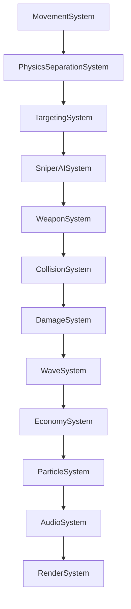

# CYBER CORE: GEOMETRIC NEON CYBERPUNK TOWER DEFENSE
## Полная техническая и архитектурная спецификация проекта (CODEX)

> **Версия спецификации:** 2.6  
> **Дата обновления:** 18 октября 2026  
> **Назначение документа:** Единый источник истины (Single Source of Truth) для передачи контекста в OpenAI Codex / Claude / GPT / AI-агентам и разработчикам.

---

## 1. ОБЗОР ПРОЕКТА

**Cyber Core** — это высокопроизводительная 2D игра в жанре Tower Defense в неоновой геометрической киберпанк-стилистике. Разработана на чистом JavaScript (ES Modules) с использованием HTML5 Canvas 2D и процедурного Web Audio API.

### Ключевые особенности
* **ECS-архитектура (Entity Component System):** Строгое разделение состояния (DTO-компоненты), бизнес-логики (системы) и управления сущностями (`World`, `EntityManager`).
* **Zero Dependencies (Zero-runtime):** Никаких сторонних библиотек, движков (Pixi, Phaser) или npm-пакетов для рантайма. Полная независимость и мгновенная загрузка.
* **Совместимость с Яндекс Играми (Yandex Games):**
  * Глушение всех звуков (SFX и BGM) при потере фокуса (`blur`, `visibilitychange`).
  * Блокировка контекстного меню (`contextmenu`), выделения текста (`selectstart`) и перетаскивания (`dragstart`).
  * Предотвращение свайп-обновлений (`touchmove` pull-to-refresh) на сенсорных устройствах.
  * Адаптивный респонсив под любые экраны: смартфоны (портрет/альбом), планшеты, десктопы, Smart TV.
* **Масштабирование без искажений:** Автоматический пересчет и масштабирование координат сущностей при ресайзе окна. Игра не сдвигает врагов относительно башни.
* **Глубокий космический фон:** 3-слойный параллакс с туманностями, мерцающими созвездиями и кибер-частицами, привязанный к канонической виртуальной системе координат ($2400 \times 1600$).

---

## 2. СТЕК ТЕХНОЛОГИЙ

| Уровень | Технологии |
|---|---|
| **Язык** | JavaScript (ES6+ ES Modules) |
| **Рендеринг** | HTML5 Canvas API (2D Context) |
| **Стилизация & UI** | CSS3 (Custom Properties, Flexbox, Grid, Neon Glow Filters, Backdrop-filter) |
| **Шрифты** | Google Fonts (`Orbitron`, `Rajdhani`) |
| **Аудио** | Web Audio API (Процедурный синтез SFX + фоновая музыка с кроссфейдом) |
| **Сборка** | Node.js автономный сборщик (`build.js`) в единый HTML файл |
| **Архитектура** | ECS (Entity Component System) + EventBus |

---

## 3. СТРУКТУРА ПРОЕКТА

```text
b:/TD game/
├── css/
│   └── style.css                 # Все неоновые стили, адаптивные медиазапросы, оверлеи
├── music/
│   ├── track1.mp3                # Фоновый эмбиент-трек 1
│   └── track2.mp3                # Фоновый эмбиент-трек 2
├── src/
│   ├── components/               # Чистые DTO (хранилища данных, без логики)
│   │   ├── ArmorComponent.js
│   │   ├── AttackComponent.js
│   │   ├── CircleColliderComponent.js
│   │   ├── EconomyComponent.js
│   │   ├── EnemyComponent.js
│   │   ├── HealthComponent.js
│   │   ├── ProjectileComponent.js
│   │   ├── RenderComponent.js
│   │   ├── TargetComponent.js
│   │   ├── TowerComponent.js
│   │   ├── TransformComponent.js
│   │   └── VelocityComponent.js
│   ├── config/
│   │   └── GameConfig.js         # Центральный конфиг баланса, цветов, волн и улучшений
│   ├── core/                     # Ядро ECS
│   │   ├── EntityManager.js      # Пул сущностей и переиспользование ID
│   │   ├── EventBus.js           # Синхронная шина событий
│   │   └── World.js              # Центральный координатор мира, сторы компонентов, очередь удаления
│   ├── managers/
│   │   └── UpgradeManager.js     # Прокачка характеристик, зависимости, экспоненциальная стоимость
│   ├── systems/                  # Конвейер логики (системы обновляются каждый кадр)
│   │   ├── AudioSystem.js        # Web Audio синтезатор и менеджер BGM
│   │   ├── CollisionSystem.js    # Коллизии снарядов и контакт врагов с башней
│   │   ├── DamageSystem.js       # Расчет поглощения брони, нанесение урона, триггер смерти
│   │   ├── EconomySystem.js      # Баланс кредитов, награды за убийства и волны
│   │   ├── MovementSystem.js     # Движение сущностей, тактическое поведение снайперов и Аегиса
│   │   ├── ParticleSystem.js     # Осколки, ударные кольца, всплывающие цифры валюты
│   │   ├── PhysicsSeparationSystem.js # Мягкое отталкивание столпившихся врагов
│   │   ├── RenderSystem.js       # Отрисовка мира, космоса, сеток, башни, пуль, интерфейса
│   │   ├── SniperAISystem.js     # Дальний бой врагов-снайперов и укрытие под куполом Аегиса
│   │   ├── TargetingSystem.js    # Ближайшая цель, предсказание урона и предварительное наведение вне радиуса
│   │   ├── WaveSystem.js         # Спавн волн, боссы, таймер перерыва, Splitter-механика
│   │   └── WeaponSystem.js       # Одноствольная пушка башни, предиктивная фильтрация, выстрелы
│   ├── ui/
│   │   └── UIManager.js          # Контроллер интерфейса, кэш DOM-карточек, база знаний врагов
│   └── main.js                   # Точка входа GameApp, главный цикл, ресайз и масштабирование
├── test_builds/                  # Сгенерированные standalone сборки игры
├── build.js                      # Скрипт сборки в один самодостаточный HTML
├── index.html                    # Разметка UI, модальные окна, канвас
├── server.js                     # Локальный статический сервер разработки
└── CODEX.md                      # Данный документ
```

---

## 4. ПАЙПЛАЙН СИСТЕМ (ПОРЯДОК ВЫПОЛНЕНИЯ В КАДРЕ)

Системы регистрируются и выполняются в строго определенном порядке в методе `_setupECS()` файла `src/main.js`:



1. **MovementSystem:** Движение врагов к башне; расчет векторов с учетом сопровождения Аегиса.
2. **PhysicsSeparationSystem:** Разрешение взаимных пересечений между врагами (мягкое расталкивание).
3. **TargetingSystem:** Поиск актуальной цели для орудия башни по выбранному алгоритму.
4. **SniperAISystem:** Остановка снайперов на периметре или под куполом Аегиса, прицеливание и стрельба.
5. **WeaponSystem:** Наведение ствола пушки башни, предиктивная фильтрация целей, выстрелы снарядами.
6. **CollisionSystem:** Детекция попаданий снарядов по врагам, пуль снайпера по башне, контактных атак.
7. **DamageSystem:** Расчет урона через процентную и фиксированную броню, вычитание HP, вызов смерти.
8. **WaveSystem:** Спавн врагов по периметру экрана, таймер волн/перерывов, вращение щитов босса, деление Splitter.
9. **EconomySystem:** Начисление наград за убийства и закрытие волн с учетом множителей и скейлинга.
10. **ParticleSystem:** Анимация осколков, ударных волн и всплывающих меток наград `+X ◈`.
11. **AudioSystem:** Обновление звуков, плавный кроссфейд между фоновыми треками.
12. **RenderSystem:** Отрисовка кадра: космос -> сетки -> башня -> купола -> враги -> снаряды -> эффекты -> оверлей паузы.

В конце каждого тика главного цикла вызывается `world._flushDestructionQueue()`, уничтожающий все помеченные сущности из пулов.

---

## 5. АРХИТЕКТУРА ECS: ЯДРО (`src/core/`)

### `EntityManager.js`
* Генератор уникальных целочисленных идентификаторов (`entityId`).
* Повторно использует освободившиеся ID через стек `recycledIds`.
* Отслеживает живые сущности в `Set<number> activeEntities`.

### `EventBus.js`
* Легковесная шина событий (`Map<string, Set<Function>>`).
* Методы: `on(event, handler)`, `off(event, handler)`, `emit(event, data)`, `clear()`.
* Обеспечивает полную изоляцию систем — системы не вызывают методы друг друга напрямую, а взаимодействуют через события:
  * `START_GAME`, `RESTART_GAME`, `RETURN_TO_MENU`, `PAUSE_TOGGLED`
  * `WAVE_STARTED`, `WAVE_PROGRESS`, `WAVE_COMPLETED`, `INTERMISSION_TICK`
  * `ENTITY_DIED`, `DAMAGE_DEALT`, `TOWER_DAMAGED`, `GAME_OVER`
  * `PROJECTILE_FIRED`, `CREDITS_CHANGED`, `UPGRADE_PURCHASED`, `AUDIO_UNLOCKED`

### `World.js`
* Хранилище компонентов: `Map<ComponentClass, Map<entityId, instance>>`.
* Запрос сущностей с набором компонентов: `getEntitiesWith(...componentClasses)` (оптимизирован через поиск наименьшего пула).
* Очередь отложенного уничтожения: `destructionQueue = new Set()`. Метод `destroyEntity(id)` помещает сущность в очередь, а `_flushDestructionQueue()` очищает все ее компоненты в конце кадра.
* Свойства мира:
  * `width`, `height` — логические размеры мира (с учетом `renderScale`).
  * `renderScale` — виртуальный масштаб рендера для мобильных устройств.
  * `isPaused`, `gameSpeed` (1.0, 2.0, 3.0), `isGameOver`, `inMenu`.

---

## 6. СПЕЦИФИКАЦИЯ КОМПОНЕНТОВ (`src/components/`)

Все компоненты являются «чистыми структурами данных» (DTO) без методов бизнес-логики:

| Компонент | Свойства | Описание |
|---|---|---|
| **`TransformComponent`** | `x, y, rotation` | Позиция в пикселях и угол поворота (в радианах). |
| **`VelocityComponent`** | `vx, vy, baseSpeed, currentSpeed` | Векторы скорости и скалярная скорость. |
| **`CircleColliderComponent`** | `radius, mass, isStatic` | Круговой коллайдер для физики и урона. |
| **`HealthComponent`** | `current, max, regenRate` | Текущее и максимальное здоровье, регенерация HP/сек. |
| **`ArmorComponent`** | `percentReduction, flatReduction` | Процентное ($0..0.85$) и плоское поглощение входящего урона. |
| **`AttackComponent`** | `damage, attackSpeed, range, cooldown, critChance, critMultiplier, multishotCount, multishotChance, distanceBonus` | Боевые характеристики атакующей сущности. |
| **`TargetComponent`** | `targetEntityId` | Ближайшая цель башни, включая сопровождение за пределами радиуса стрельбы. |
| **`RenderComponent`** | `shape, sides, radius, color, glowColor, glowBlur` | Геометрия отрисовки (`'polygon'`, `'circle'`, `'tower'`, `'projectile'`). |
| **`TowerComponent`** | *нет свойств (tag-компонент)* | Идентифицирует главную башню игрока. |
| **`EnemyComponent`** | `type, baseReward, isSniper, shootCooldown, shootInterval, stopDistance, rotationSpeed, damage, meleeCooldown, meleeInterval, shieldDomeRadius, isStopped, aegisTargetId, blinkCooldown, shieldIds, shieldOrbitRadius, shieldOrbitSpeed, shieldOrbitAngle, scatterTimer` | Метаданные типа врага, таймеры атак, состояния босса и щитов. |
| **`ProjectileComponent`** | `sourceEntityId, targetEntityId, lifetime, maxLifetime, damage, isCrit, isEnemy, originX, originY, distanceBonus` | Данные летящего снаряда. |
| **`EconomyComponent`** | `credits, killMultiplier, waveMultiplier` | Баланс кредитов башни и множители дохода. |

---

## 7. БЕСТИАРИЙ ВРАГОВ И ИИ-МЕХАНИКИ

В игре 8 основных типов врагов + защитный сегмент щита босса. Каждый тип имеет уникальную геометрию и поведение:

### 1. Скаут (`scout`)
* **Форма:** Треугольник (3 стороны), цвет `#ffe600` (неоново-желтый).
* **Поведение:** Быстрый легкий авангард, нападает большими группами. Низкое HP, средняя скорость.

### 2. Истребитель (`fighter`)
* **Форма:** Квадрат (4 стороны), цвет `#ff0055` (неоново-красный/малиновый).
* **Поведение:** Сбалансированный линейный штурмовик, умеренное HP и урон при контакте.

### 3. Танк (`tank`)
* **Форма:** Пятиугольник (5 сторон), цвет `#9d00ff` (неоново-фиолетовый).
* **Поведение:** Тяжелобронированная медленная единица с огромным запасом HP.

### 4. Снайпер (`sniper`)
* **Форма:** Шестиугольник (6 сторон) с длинным направленным прицельным лучом, цвет `#ff7700` (оранжевый).
* **Поведение:** Не летит вплотную к башне. Останавливается на границе зоны поражения башни ($90\%$ от `attack.range`, максимум 240px). Заряжает и выпускает дальнобойные оранжевые снаряды в ядро.

### 5. Аегис (`aegis`)
* **Форма:** Восьмиугольник (8 сторон), цвет `#00e5ff` (неоново-бирюзовый).
* **Поведение (Синергия Снайпер-Аегис):**
  * Генерирует вокруг себя большой защитный энергетический купол (радиус 115px) с пульсирующей сотовой сеткой.
  * Если поблизости есть снайпер, снайпер стремится влететь внутрь купола Аегиса.
  * Если Аегис несет под своим куполом снайпера, он останавливается вместе с ним на огневой позиции у границы радиуса башни, создавая защищенный мобильный бункер.
  * Если снайперов рядом нет или они погибли, Аегис идет на таран башни как обычный враг.

### 6. Сплиттер (`splitter` и `splitter_shard`)
* **Форма:** Семиугольник (7 сторон), цвет `#00ff66` (кислотно-зеленый).
* **Поведение:** При уничтожении взрывается и разделяется на 3 малых быстрых осколка (`splitter_shard`), которые с импульсом разлетаются в стороны и затем устремляются к башне.

### 7. Блинкер (`blinker`)
* **Форма:** Ромб (4 вытянутые стороны), цвет `#ffffff` (чистый неоновый белый).
* **Поведение:** Каждые 2 секунды совершает мгновенный телепортационный рывок (даш) на 85px вперед к башне, оставляя за собой электрический искровой след и звуковой импульс.

### 8. Архитектор / Босс (`boss_architect` и `boss_shield`)
* **Форма:** Десятиугольник (10 сторон), цвет `#ff0055` (массивная фигура с пульсирующим ядром). Появляется каждые 10 волн (10, 20, 30...).
* **Поведение:** Вокруг босса по орбите вращаются 8 автономных энергетических щитов (`boss_shield`). Щиты принимают на себя все снаряды башни, прикрывая ядро босса. Только после пробития щитов можно нанести урон самому боссу.

---

## 8. СИСТЕМА УЛУЧШЕНИЙ (13 АПГРЕЙДОВ)

Улучшения разделены на 3 категории и настраиваются в `GameConfig.upgrades`. Стоимость каждого уровня масштабируется экспоненциально:
$$\text{Cost} = \text{round}\left(\text{baseCost} \cdot \text{costMultiplier}^{\text{level}}\right)$$

### Категория: Оружие (`offense`)
1. **Урон оружия (`damage`):** База 25 DMG, +6 DMG/ур., база $25◈$, множитель 1.25.
2. **Скорость атаки (`attackSpeed`):** База 1.6/сек, +0.15/сек/ур., база $35◈$, множитель 1.28.
3. **Расширение зоны атаки (`range`):** База 130px, +8px/ур. (макс. ур. 20, до 290px), база $30◈$, множитель 1.25.
4. **Шанс крита (`critChance`):** База 8%, +2%/ур. (макс. ур. 36, до 80%), база $40◈$, множитель 1.32.
5. **Крит. урон (`critDamage`):** База 1.6x, +0.25x/ур., база $45◈$, множитель 1.30.
6. **Шанс мультивыстрела (`multishotChance`):** База 0%, +0.5%/ур. (макс. ур. 40, до 20%), база $45◈$, множитель 1.30.
7. **Цели мультивыстрела (`multishotTargets`):** База +1 цель, +1 цель/ур. (макс. ур. 5), база $80◈$, множитель 1.70.  
   * **Требование разблокировки:** `requires: { id: 'multishotChance', minLevel: 1 }`. Пока не куплен хотя бы 1 уровень шанса мультивыстрела, покупка целей заблокирована (`ТРЕБУЕТСЯ: МУЛЬТИВЫСТРЕЛ`).

### Категория: Защита (`defense`)
8. **Макс. прочность (`maxHealth`):** База 600 HP, +80 HP/ур., база $30◈$, множитель 1.25.
9. **Броня % (`armorPercent`):** База 0%, +3%/ур. (макс. ур. 28, кап 85%), база $40◈$, множитель 1.32.
10. **Поглощение урона (`flatArmor`):** База 0 DMG, -3 DMG/ур., база $35◈$, множитель 1.28.
11. **Регенерация HP (`healthRegen`):** База 1.0 HP/сек, +1.5 HP/сек/ур., база $40◈$, множитель 1.30.

### Категория: Экономика (`utility`)
12. **Бонус за убийства (`killCashBonus`):** База 1.0x, +12%/ур. к награде за врагов, база $40◈$, множитель 1.28.
13. **Бонус за волну (`waveCashBonus`):** База 1.0x, +15%/ур. к награде за очистку волны, база $50◈$, множитель 1.30.

---

## 9. ЭКОНОМИКА И БАЛАНС ВОЛН

### Формулы масштабирования врагов (от волны $W$)
* **Здоровье врагов:** $\text{HP}_W = \text{baseHp} \cdot 1.10^{W - 1}$
* **Урон врагов:** $\text{Damage}_W = \text{baseDamage} \cdot 1.07^{W - 1}$
* **Награда за убийство:** $\text{Reward}_W = \max\left(1, \text{round}\left(\text{baseReward} \cdot 1.04^{W - 1} \cdot \text{killMultiplier}\right)\right)$
* **Награда за завершение волны:**
  $$\text{WaveClearEarned} = \text{round}\left((50 + W \cdot 25) \cdot 1.04^{W - 1} \cdot \text{waveMultiplier}\right)$$

### Спавн врагов вне экрана
Враги спавнятся строго за пределами видимого экрана по прямоугольному периметру, динамически адаптированному под текущие размеры канваса:
* Отступ `margin`: 125px для Босса (с учетом радиуса щитов) и 55-80px для рядовых врагов.
* Спавн полностью исключает внезапное появление противников в поле зрения игрока на любых экранах и ориентациях.

---

## 10. ОРУЖИЕ БАШНИ И ПРЕДИКТИВНЫЙ ВЫСТРЕЛ (`WeaponSystem.js`)

Башня оснащена **одноствольной поворотной пушкой**. Чтобы исключить стрельбу впустую по врагам, которые уже гарантированно погибнут от ранее выпущенных летящих пуль:
1. Система суммирует входящий в каждого врага урон от снарядов в воздухе (`inFlightDamage`).
2. Фильтрует цели по эффективному здоровью: $\text{effectiveHp} = \text{currentHp} - \text{inFlightDamage} > 0$.
3. Если все враги в радиусе уже «смертники», башня экономит выстрелы и не стреляет в пустоту.
4. При срабатывании мультивыстрела пушка выпускает ровно столько снарядов, сколько реальных живых целей находится в зоне поражения (не стреляет в никуда).

---

## 11. АУДИОСИСТЕМА (`AudioSystem.js`)

* **Процедурные SFX через Web Audio API:**
  * Лазерный выстрел башни, попадания, критические удары, взрывы, телепортация Блинкера, сигналы волн и боссов.
  * Не требует внешних аудиофайлов для звуковых эффектов.
* **Фоновая музыка (BGM):**
  * Воспроизводит `music/track1.mp3` и `music/track2.mp3` в случайном порядке.
  * Бесшовный непрерывный кроссфейд (переход) между треками без тишины.
  * Пауза при паузе игры и в главном меню; автоматический рестарт музыки при перезапуске сессии.
* **Независимые регуляторы громкости:**
  * Кнопки **ЗВУК** и **МУЗЫКА** в шапке HUD и главном меню:
    * ЛКМ — циклическое переключение громкости ($100\% \to 60\% \to 30\%$).
    * ПКМ — быстрое отключение / включение звука (Mute).
* **Соблюдение требований Яндекс Игр:**
  * При потере фокуса окна (`window.blur`, `visibilitychange === 'hidden'`) глушится и музыка, и все геймплейные звуки (`ctx.suspend()`).
  * При возврате фокуса звук автоматически возобновляется (`ctx.resume()`).

---

## 12. ГРАФИКА И МАСШТАБИРОВАНИЕ РЕНДЕРА (`RenderSystem.js`)

### Виртуальный масштаб камеры (`renderScale`)
Для мобильных устройств с наименьшей стороной экрана менее 640px рассчитывается виртуальный масштаб:
$$\text{world.renderScale} = \frac{\min(\text{width}, \text{height})}{640}, \quad \text{world.width} = \frac{\text{width}}{\text{renderScale}}, \quad \text{world.height} = \frac{\text{height}}{\text{renderScale}}$$
Мир отрисовывается в логических координатах внутри `ctx.save()` / `ctx.scale(scale, scale)` / `ctx.restore()`.

### Пропорциональный ресайз мира (`_resizeCanvas()` в `main.js`)
При динамическом изменении размеров окна (поворот смартфона, открытие инспектора, ресайз браузера):
1. Рассчитываются коэффициенты:
   $$\text{scaleX} = \frac{\text{newLogicalWidth}}{\text{prevLogicalWidth}}, \quad \text{scaleY} = \frac{\text{newLogicalHeight}}{\text{prevLogicalHeight}}$$
2. Все координаты сущностей (`TransformComponent.x/y`), траектории снарядов и частицы пропорционально масштабируются.
3. Башня центрируется в точке `(world.width / 2, world.height / 2)`.
4. Враги сохраняют свое точное относительное положение к башне без рывков и смещений.

---

## 13. ПОЛЬЗОВАТЕЛЬСКИЙ ИНТЕРФЕЙС И ОПТИМИЗАЦИЯ DOM (`UIManager.js`)

* **Отсутствие троттлинга DOM:**
  * Карточки апгрейдов генерируются только при старте, смене вкладок («ОРУЖИЕ», «ЗАЩИТА», «ЭКОНОМИКА») или рестарте (`renderUpgrades`).
  * Ссылки на DOM-узлы кэшируются в `Map` (`upgradeCardsMap`).
  * При изменении кредитов (`CREDITS_CHANGED`) и покупке апгрейда (`UPGRADE_PURCHASED`) вызывается легковесный метод `updateUpgradeCards()`, точечно обновляющий только текст и классы `.disabled` / `.maxed` / `.locked`.
* **База данных врагов (Enemy Intel):**
  * В модальном окне базы знаний врагов отрисованы живые неоновые миниатюры сущностей на канвасах через `EnemyIntelRenderer` в реальном времени.

---

## 14. СБОРКА И ДЕПЛОЙ (`build.js`)

Скрипт `build.js` собирает проект в единый самодостаточный HTML-файл для заливки на порталы (Яндекс Игры, VK Play, itch.io):
```bash
node build.js release_v0.3.html
```

### Алгоритм сборщика:
1. Считывает `index.html` и `css/style.css`.
2. Вставляет содержимое CSS внутрь тега `<style>` в шапке.
3. Считывает 31 модуль из `src/` в строгом топологическом порядке зависимостей.
4. Вырезает `import` и `export`, оборачивает модули в единый IIFE-бандл.
5. Копирует папку `music/` в целевую директорию сборки (`test_builds/`).
6. Выводит итоговый размер собранного HTML файла.

---

## 15. ЗОЛОТЫЕ ПРАВИЛА ДЛЯ РАЗРАБОТЧИКОВ И ИИ-АГЕНТОВ (RULES FOR CODEX)

1. **Вносить изменения СТРОГО в исходные модули `src/`**, а не в собранные файлы в `test_builds/`.
2. **Сохранять чистую архитектуру ECS:**
   * Компоненты (`src/components/`) содержат ТОЛЬКО данные (никаких методов, расчетов или логики).
   * Системы (`src/systems/`) содержат логику и методы `update(world, deltaTime)`.
   * Системы взаимодействуют между собой ТОЛЬКО через `world.eventBus` или чтение компонентов через `world.getEntitiesWith(...)`.
3. **Не ломать кэширование DOM в UI:** Никогда не возвращать `innerHTML = ''` при получении кредитов в `UIManager.js`.
4. **Контролировать строгие булевы типы:** При использовании `classList.toggle('class', force)` убеждаться, что `force` — строго `boolean` (`Boolean(...)`), иначе передача `undefined` приводит к циклическому инвертированию класса в DOM.
5. **Поддерживать Yandex Games Compliance:** Сохранять обработчики глушения аудио при потере фокуса и защиту от скролла/контекстного меню.
6. **Кэш-бастинг при обновлении модулей:** При внесении правок в модули обновлять версию запроса в `index.html` и `src/main.js` (например, `?v=2.7`).
7. **Сборки и git push:** Выполнять `build.js` или `git push` строго по прямой разовой команде пользователя.
