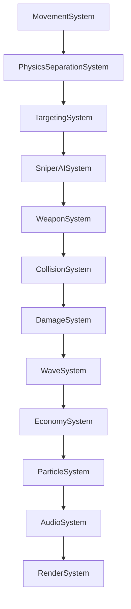

# CYBER CORE: GEOMETRIC NEON CYBERPUNK TOWER DEFENSE
## Полная техническая и архитектурная спецификация проекта (CODEX)

> **Версия спецификации:** 2.6  
> **Дата обновления:** 18 октября 2026  
> **Назначение документа:** Единый источник истины (Single Source of Truth) для передачи контекста в OpenAI Codex / Claude / GPT / AI-агентам и разработчикам.

---

## 1. ОБЗОР ПРОЕКТА

**Cyber Core** — это высокопроизводительная 2D игра в жанре Tower Defense в неоновой геометрической киберпанк-стилистике. Разработана на чистом JavaScript (ES Modules) с использованием HTML5 Canvas 2D и процедурного Web Audio API.

### Ключевые особенности
* **ECS-архитектура (Entity Component System):** Строгое разделение состояния (DTO-компоненты), бизнес-логики (системы) и управления сущностями (`World`, `EntityManager`).
* **Zero Dependencies (Zero-runtime):** Никаких сторонних библиотек, движков (Pixi, Phaser) или npm-пакетов для рантайма. Полная независимость и мгновенная загрузка.
* **Совместимость с Яндекс Играми (Yandex Games):**
  * Глушение всех звуков (SFX и BGM) при потере фокуса (`blur`, `visibilitychange`).
  * Блокировка контекстного меню (`contextmenu`), выделения текста (`selectstart`) и перетаскивания (`dragstart`).
  * Предотвращение свайп-обновлений (`touchmove` pull-to-refresh) на сенсорных устройствах.
  * Адаптивный респонсив под любые экраны: смартфоны (портрет/альбом), планшеты, десктопы, Smart TV.
* **Масштабирование без искажений:** Автоматический пересчет и масштабирование координат сущностей при ресайзе окна. Игра не сдвигает врагов относительно башни.
* **Глубокий космический фон:** 3-слойный параллакс с туманностями, мерцающими созвездиями и кибер-частицами, привязанный к канонической виртуальной системе координат ($2400 \times 1600$).

---

## 2. СТЕК ТЕХНОЛОГИЙ

| Уровень | Технологии |
|---|---|
| **Язык** | JavaScript (ES6+ ES Modules) |
| **Рендеринг** | HTML5 Canvas API (2D Context) |
| **Стилизация & UI** | CSS3 (Custom Properties, Flexbox, Grid, Neon Glow Filters, Backdrop-filter) |
| **Шрифты** | Локальный `WDXL Lubrifont SC` (интерфейс и Canvas), `Orbitron 900` (логотип); WOFF2, SIL OFL 1.1 |
| **Аудио** | Web Audio API (Процедурный синтез SFX + фоновая музыка с кроссфейдом) |
| **Сборка** | Node.js автономный сборщик (`build.js`) в единый HTML файл |
| **Архитектура** | ECS (Entity Component System) + EventBus |

---

## 3. СТРУКТУРА ПРОЕКТА

```text
b:/TD game/
├── css/
│   └── style.css                 # Все неоновые стили, адаптивные медиазапросы, оверлеи
├── music/
│   ├── track1.mp3                # Фоновый эмбиент-трек 1
│   └── track2.mp3                # Фоновый эмбиент-трек 2
├── src/
│   ├── components/               # Чистые DTO (хранилища данных, без логики)
│   │   ├── ArmorComponent.js
│   │   ├── AttackComponent.js
│   │   ├── CircleColliderComponent.js
│   │   ├── EconomyComponent.js
│   │   ├── EnemyComponent.js
│   │   ├── HealthComponent.js
│   │   ├── ProjectileComponent.js
│   │   ├── RenderComponent.js
│   │   ├── TargetComponent.js
│   │   ├── TowerComponent.js
│   │   ├── TransformComponent.js
│   │   └── VelocityComponent.js
│   ├── config/
│   │   └── GameConfig.js         # Центральный конфиг баланса, цветов, волн и улучшений
│   ├── core/                     # Ядро ECS
│   │   ├── EntityManager.js      # Пул сущностей и переиспользование ID
│   │   ├── EventBus.js           # Синхронная шина событий
│   │   └── World.js              # Центральный координатор мира, сторы компонентов, очередь удаления
│   ├── managers/
│   │   └── UpgradeManager.js     # Прокачка характеристик, зависимости, экспоненциальная стоимость
│   ├── systems/                  # Конвейер логики (системы обновляются каждый кадр)
│   │   ├── AudioSystem.js        # Web Audio синтезатор и менеджер BGM
│   │   ├── CollisionSystem.js    # Коллизии снарядов и контакт врагов с башней
│   │   ├── DamageSystem.js       # Расчет поглощения брони, нанесение урона, триггер смерти
│   │   ├── EconomySystem.js      # Баланс кредитов, награды за убийства и волны
│   │   ├── MovementSystem.js     # Движение сущностей, тактическое поведение снайперов и Аегиса
│   │   ├── ParticleSystem.js     # Осколки, ударные кольца, всплывающие цифры валюты
│   │   ├── PhysicsSeparationSystem.js # Мягкое отталкивание столпившихся врагов
│   │   ├── RenderSystem.js       # Отрисовка мира, космоса, сеток, башни, пуль, интерфейса
│   │   ├── SniperAISystem.js     # Дальний бой врагов-снайперов и укрытие под куполом Аегиса
│   │   ├── TargetingSystem.js    # Ближайшая цель, предсказание урона и предварительное наведение вне радиуса
│   │   ├── WaveSystem.js         # Спавн волн, боссы, таймер перерыва, Splitter-механика
│   │   └── WeaponSystem.js       # Одноствольная пушка башни, предиктивная фильтрация, выстрелы
│   ├── ui/
│   │   └── UIManager.js          # Контроллер интерфейса, кэш DOM-карточек, база знаний врагов
│   └── main.js                   # Точка входа GameApp, главный цикл, ресайз и масштабирование
├── test_builds/                  # Сгенерированные standalone сборки игры
├── build.js                      # Скрипт сборки в один самодостаточный HTML
├── index.html                    # Разметка UI, модальные окна, канвас
├── server.js                     # Локальный статический сервер разработки
└── CODEX.md                      # Данный документ
```

---

## 4. ПАЙПЛАЙН СИСТЕМ (ПОРЯДОК ВЫПОЛНЕНИЯ В КАДРЕ)

Системы регистрируются и выполняются в строго определенном порядке в методе `_setupECS()` файла `src/main.js`:



1. **MovementSystem:** Движение врагов к башне; расчет векторов с учетом сопровождения Аегиса.
2. **PhysicsSeparationSystem:** Разрешение взаимных пересечений между врагами (мягкое расталкивание).
3. **TargetingSystem:** Поиск актуальной цели для орудия башни по выбранному алгоритму.
4. **SniperAISystem:** Остановка снайперов на периметре или под куполом Аегиса, прицеливание и стрельба.
5. **WeaponSystem:** Наведение ствола пушки башни, предиктивная фильтрация целей, выстрелы снарядами.
6. **CollisionSystem:** Детекция попаданий снарядов по врагам, пуль снайпера по башне, контактных атак.
7. **DamageSystem:** Расчет урона через процентную и фиксированную броню, вычитание HP, вызов смерти.
8. **WaveSystem:** Спавн врагов по периметру экрана, таймер волн/перерывов, финальный босс стадии, деление Splitter.
9. **EconomySystem:** Начисление наград за убийства и закрытие волн с учетом множителей и скейлинга.
10. **ParticleSystem:** Анимация осколков, ударных волн и всплывающих меток наград `+X ◈`.
11. **AudioSystem:** Обновление звуков, плавный кроссфейд между фоновыми треками.
12. **RenderSystem:** Отрисовка кадра: космос -> сетки -> башня -> купола -> враги -> снаряды -> эффекты -> оверлей паузы.

В конце каждого тика главного цикла вызывается `world._flushDestructionQueue()`, уничтожающий все помеченные сущности из пулов.

---

## 5. АРХИТЕКТУРА ECS: ЯДРО (`src/core/`)

### `EntityManager.js`
* Генератор уникальных целочисленных идентификаторов (`entityId`).
* Повторно использует освободившиеся ID через стек `recycledIds`.
* Отслеживает живые сущности в `Set<number> activeEntities`.

### `EventBus.js`
* Легковесная шина событий (`Map<string, Set<Function>>`).
* Методы: `on(event, handler)`, `off(event, handler)`, `emit(event, data)`, `clear()`.
* Обеспечивает полную изоляцию систем — системы не вызывают методы друг друга напрямую, а взаимодействуют через события:
  * `START_GAME`, `RESTART_GAME`, `RETURN_TO_MENU`, `PAUSE_TOGGLED`
  * `WAVE_STARTED`, `WAVE_PROGRESS`, `WAVE_COMPLETED`, `INTERMISSION_TICK`
  * `ENTITY_DIED`, `DAMAGE_DEALT`, `TOWER_DAMAGED`, `GAME_OVER`
  * `PROJECTILE_FIRED`, `CREDITS_CHANGED`, `UPGRADE_PURCHASED`, `AUDIO_UNLOCKED`

### `World.js`
* Хранилище компонентов: `Map<ComponentClass, Map<entityId, instance>>`.
* Запрос сущностей с набором компонентов: `getEntitiesWith(...componentClasses)` (оптимизирован через поиск наименьшего пула).
* Очередь отложенного уничтожения: `destructionQueue = new Set()`. Метод `destroyEntity(id)` помещает сущность в очередь, а `_flushDestructionQueue()` очищает все ее компоненты в конце кадра.
* Свойства мира:
  * `width`, `height` — логические размеры мира (с учетом `renderScale`).
  * `renderScale` — виртуальный масштаб рендера для мобильных устройств.
  * `isPaused`, `gameSpeed` (1.0, 2.0, 3.0), `isGameOver`, `inMenu`.

---

## 6. СПЕЦИФИКАЦИЯ КОМПОНЕНТОВ (`src/components/`)

Все компоненты являются «чистыми структурами данных» (DTO) без методов бизнес-логики:

| Компонент | Свойства | Описание |
|---|---|---|
| **`TransformComponent`** | `x, y, rotation` | Позиция в пикселях и угол поворота (в радианах). |
| **`VelocityComponent`** | `vx, vy, baseSpeed, currentSpeed` | Векторы скорости и скалярная скорость. |
| **`CircleColliderComponent`** | `radius, mass, isStatic` | Круговой коллайдер для физики и урона. |
| **`HealthComponent`** | `current, max, regenRate` | Текущее и максимальное здоровье, регенерация HP/сек. |
| **`ArmorComponent`** | `percentReduction, flatReduction` | Процентное ($0..0.85$) и плоское поглощение входящего урона. |
| **`AttackComponent`** | `damage, attackSpeed, range, cooldown, critChance, critMultiplier, multishotCount, multishotChance, distanceBonus` | Боевые характеристики атакующей сущности. |
| **`TargetComponent`** | `targetEntityId` | Ближайшая цель башни, включая сопровождение за пределами радиуса стрельбы. |
| **`RenderComponent`** | `shape, sides, radius, color, glowColor, glowBlur` | Геометрия отрисовки (`'polygon'`, `'circle'`, `'tower'`, `'projectile'`). |
| **`TowerComponent`** | *нет свойств (tag-компонент)* | Идентифицирует главную башню игрока. |
| **`EnemyComponent`** | `type, baseReward, isSniper, shootCooldown, shootInterval, stopDistance, rotationSpeed, damage, meleeCooldown, meleeInterval, shieldDomeRadius, isStopped, aegisTargetId, blinkCooldown, shieldIds, shieldOrbitRadius, shieldOrbitSpeed, shieldOrbitAngle, scatterTimer` | Метаданные типа врага, таймеры атак, состояния босса и щитов. |
| **`ProjectileComponent`** | `sourceEntityId, targetEntityId, lifetime, maxLifetime, damage, isCrit, isEnemy, originX, originY, distanceBonus` | Данные летящего снаряда. |
| **`EconomyComponent`** | `credits, killMultiplier, waveMultiplier` | Баланс кредитов башни и множители дохода. |

---

## 7. БЕСТИАРИЙ ВРАГОВ И ИИ-МЕХАНИКИ

В игре 8 основных типов врагов + защитный сегмент щита босса. Каждый тип имеет уникальную геометрию и поведение:

### 1. Скаут (`scout`)
* **Форма:** Треугольник (3 стороны), цвет `#ffe600` (неоново-желтый).
* **Поведение:** Быстрый легкий авангард, нападает большими группами. Низкое HP, средняя скорость.

### 2. Истребитель (`fighter`)
* **Форма:** Квадрат (4 стороны), цвет `#ff0055` (неоново-красный/малиновый).
* **Поведение:** Манёвренный штурмовик: закрученная спираль к башне, локальный обход союзников с тыла, умеренное HP и урон при контакте.

### 3. Танк (`tank`)
* **Форма:** Пятиугольник (5 сторон), цвет `#9d00ff` (неоново-фиолетовый).
* **Поведение:** Тяжелобронированная медленная единица с огромным запасом HP.

### 4. Снайпер (`sniper`)
* **Форма:** Шестиугольник (6 сторон) с длинным направленным прицельным лучом, цвет `#ff7700` (оранжевый).
* **Поведение:** Не летит вплотную к башне. Останавливается на границе зоны поражения башни ($90\%$ от `attack.range`, максимум 240px). Заряжает и выпускает дальнобойные оранжевые снаряды в ядро.

### 5. Аегис (`aegis`)
* **Форма:** Восьмиугольник (8 сторон), цвет `#00e5ff` (неоново-бирюзовый).
* **Поведение (Синергия Снайпер-Аегис):**
  * Генерирует вокруг себя большой защитный энергетический купол (радиус 115px) с пульсирующей сотовой сеткой.
  * Если поблизости есть снайпер, снайпер стремится влететь внутрь купола Аегиса.
  * Если Аегис несет под своим куполом снайпера, он останавливается вместе с ним на огневой позиции у границы радиуса башни, создавая защищенный мобильный бункер.
  * Если снайперов рядом нет или они погибли, Аегис идет на таран башни как обычный враг.

### 6. Сплиттер (`splitter` и `splitter_shard`)
* **Форма:** Семиугольник (7 сторон), цвет `#00ff66` (кислотно-зеленый).
* **Поведение:** При уничтожении взрывается и разделяется на 3 малых быстрых осколка (`splitter_shard`), которые с импульсом разлетаются в стороны и затем устремляются к башне.

### 7. Блинкер (`blinker`)
* **Форма:** Ромб (4 вытянутые стороны), цвет `#ffffff` (чистый неоновый белый).
* **Поведение:** Каждые 2 секунды совершает мгновенный телепортационный рывок (даш) на 85px вперед к башне, оставляя за собой электрический искровой след и звуковой импульс.

### 8. Монолит / Босс (`boss_architect`)
* **Форма:** Тяжёлый восьмигранный корпус радиусом 66 px с четырьмя крупными бронеплитами, утопленным ромбическим реактором и мягким кораллово-розовым свечением (#ff7189). Звёздный фрактал и орбитальные щиты убраны.
* **Поведение:** Прямой полёт к башне со скоростью 45 (увеличение на 50%), остановка с зазором 26 px между коллайдерами и циклический лазерный бур с подготовкой и перегревом (см. раздел 29). Радиус увеличен с 44 до 66 px, реактор также масштабируется. Базовые HP 400, DPS бура 20 и награда 350; действуют обычные множители волны/стадии. На подходе корпус вращается со скоростью ±0.204 рад/с (+70%). На дистанции атаки доворачивается ближайшей широкой гранью к башне (с той же угловой скоростью 0.204 рад/с, не больше 45°), затем фиксируется. Два бура выходят из выемок двух соседних широких граней и атакуют по бокам башни, оставляя просвет для ствола; общий DPS не удваивается.
* **Отрисовка:** Общие drawArchitectBody/drawArchitectCore из src/visuals/ArchitectVisual.js используются боем и справочником через EnemyVisualCache. Корпус и реактор рисуются в ограниченные кэши, затем только drawImage; пульсация ядра меняет масштаб 0.88–1.00. В бою максимум два blit при обычном освещении и четыре на переходе покрытия Эгиды; геометрия и glow не пересоздаются на каждом кадре. HP встроено секциями в бронеплиты, внешней полоски нет.
* **Совместимость:** boss_shield и проверки старых орбит оставлены только для регрессионных тестов переиспользования ID снарядами. Штатный спавн Монолита создаёт одну сущность без shieldIds. Очистка/победа и devtools считают его одним противником.

---

## 8. СИСТЕМА УЛУЧШЕНИЙ (13 АПГРЕЙДОВ)

Улучшения разделены на 3 категории и настраиваются в `GameConfig.upgrades`. Стоимость каждого уровня масштабируется экспоненциально:
$$\text{Cost} = \text{round}\left(\text{baseCost} \cdot \text{costMultiplier}^{\text{level}}\right)$$

### Категория: Оружие (`offense`)
1. **Урон оружия (`damage`):** База 25 DMG, +6 DMG/ур., база $25◈$, множитель 1.25.
2. **Скорость атаки (`attackSpeed`):** База 1.6/сек, +0.15/сек/ур., база $35◈$, множитель 1.28.
3. **Расширение зоны атаки (`range`):** База 130px, +8px/ур. (без лимита уровней), база $30◈$, множитель 1.25.
4. **Шанс крита (`critChance`):** База 8%, +2%/ур. (без лимита уровней), база $40◈$, множитель 1.32.
5. **Крит. урон (`critDamage`):** База 1.6x, +0.25x/ур., база $45◈$, множитель 1.30.
6. **Шанс мультивыстрела (`multishotChance`):** База 0%, +0.5%/ур. (без лимита уровней), база $45◈$, множитель 1.30.
7. **Цели мультивыстрела (`multishotTargets`):** База +1 цель, +1 цель/ур. (без лимита уровней), база $80◈$, множитель 1.70.
   * **Требование разблокировки:** `requires: { id: 'multishotChance', minLevel: 1 }`. Пока не куплен хотя бы 1 уровень шанса мультивыстрела, покупка целей заблокирована (`ТРЕБУЕТСЯ: МУЛЬТИВЫСТРЕЛ`).

### Категория: Защита (`defense`)
8. **Макс. прочность (`maxHealth`):** База 300 HP, +80 HP/ур., база $30◈$, множитель 1.25.
9. **Броня % (`armorPercent`):** База 0%, +3%/ур. (без лимита уровней), база $40◈$, множитель 1.32.
10. **Поглощение урона (`flatArmor`):** База 0 DMG, -3 DMG/ур., база $35◈$, множитель 1.28.
11. **Регенерация HP (`healthRegen`):** База 1.0 HP/сек, +1.5 HP/сек/ур., база $40◈$, множитель 1.30.

### Категория: Экономика (`utility`)
12. **Бонус за убийства (`killCashBonus`):** База 1.0x, +12%/ур. к награде за врагов, база $40◈$, множитель 1.28.
13. **Бонус за волну (`waveCashBonus`):** База 1.0x, +15%/ур. к награде за очистку волны, база $50◈$, множитель 1.30.

---

## 9. ЭКОНОМИКА И БАЛАНС ВОЛН

### Формулы масштабирования врагов (от волны $W$)
* **Здоровье врагов:** $\text{HP}_W = \text{baseHp} \cdot 1.10^{W - 1}$
* **Урон врагов:** $\text{Damage}_W = \text{baseDamage} \cdot 1.07^{W - 1}$
* **Награда за убийство:** $\text{Reward}_W = \max\left(1, \text{round}\left(\text{baseReward} \cdot 1.04^{W - 1} \cdot \text{killMultiplier}\right)\right)$
* **Награда за завершение волны:**
  $$\text{WaveClearEarned} = \text{round}\left((50 + W \cdot 25) \cdot 1.04^{W - 1} \cdot \text{waveMultiplier}\right)$$

### Спавн врагов вне экрана
Враги спавнятся строго за пределами видимого экрана по прямоугольному периметру, динамически адаптированному под текущие размеры канваса:
* Отступ `margin`: radius + 30px для Монолита (96px) и 55-80px для рядовых врагов.
* Спавн полностью исключает внезапное появление противников в поле зрения игрока на любых экранах и ориентациях.

---

## 10. ОРУЖИЕ БАШНИ И ПРЕДИКТИВНЫЙ ВЫСТРЕЛ (`WeaponSystem.js`)

Башня оснащена **одноствольной поворотной пушкой**. Чтобы исключить стрельбу впустую по врагам, которые уже гарантированно погибнут от ранее выпущенных летящих пуль:
1. Система суммирует входящий в каждого врага урон от снарядов в воздухе (`inFlightDamage`).
2. Фильтрует цели по эффективному здоровью: $\text{effectiveHp} = \text{currentHp} - \text{inFlightDamage} > 0$.
3. Если все враги в радиусе уже «смертники», башня экономит выстрелы и не стреляет в пустоту.
4. При срабатывании мультивыстрела пушка выпускает ровно столько снарядов, сколько реальных живых целей находится в зоне поражения (не стреляет в никуда).

---

## 11. АУДИОСИСТЕМА (`AudioSystem.js`)

* **Процедурные SFX через Web Audio API:**
  * Лазерный выстрел башни, попадания, критические удары, взрывы, телепортация Блинкера, сигналы волн и боссов.
  * Не требует внешних аудиофайлов для звуковых эффектов.
* **Фоновая музыка (BGM):**
  * Воспроизводит все четыре файла `music/background_music_1.mp3` — `music/background_music_4.mp3`: перемешанная очередь без повторов подряд, с плавным переходом между треками.
  * Бесшовный непрерывный кроссфейд (переход) между треками без тишины.
  * Пауза при паузе игры и в главном меню; автоматический рестарт музыки при перезапуске сессии.
* **Независимые регуляторы громкости:**
  * Кнопки **ЗВУК** и **МУЗЫКА** в шапке HUD и главном меню:
    * ЛКМ — циклическое переключение громкости ($100\% \to 60\% \to 30\%$).
    * ПКМ — быстрое отключение / включение звука (Mute).
* **Соблюдение требований Яндекс Игр:**
  * При потере фокуса окна (`window.blur`, `visibilitychange === 'hidden'`) глушится и музыка, и все геймплейные звуки (`ctx.suspend()`).
  * При возврате фокуса звук автоматически возобновляется (`ctx.resume()`).

---

## 12. ГРАФИКА И МАСШТАБИРОВАНИЕ РЕНДЕРА (`RenderSystem.js`)

### Виртуальный масштаб камеры (`renderScale`)
Для мобильных устройств с наименьшей стороной экрана менее 640px рассчитывается виртуальный масштаб:
$$\text{world.renderScale} = \frac{\min(\text{width}, \text{height})}{640}, \quad \text{world.width} = \frac{\text{width}}{\text{renderScale}}, \quad \text{world.height} = \frac{\text{height}}{\text{renderScale}}$$
Мир отрисовывается в логических координатах внутри `ctx.save()` / `ctx.scale(scale, scale)` / `ctx.restore()`.

### Пропорциональный ресайз мира (`_resizeCanvas()` в `main.js`)
При динамическом изменении размеров окна (поворот смартфона, открытие инспектора, ресайз браузера):
1. Рассчитываются коэффициенты:
   $$\text{scaleX} = \frac{\text{newLogicalWidth}}{\text{prevLogicalWidth}}, \quad \text{scaleY} = \frac{\text{newLogicalHeight}}{\text{prevLogicalHeight}}$$
2. Все координаты сущностей (`TransformComponent.x/y`), траектории снарядов и частицы пропорционально масштабируются.
3. Башня центрируется в точке `(world.width / 2, world.height / 2)`.
4. Враги сохраняют свое точное относительное положение к башне без рывков и смещений.

---

## 13. ПОЛЬЗОВАТЕЛЬСКИЙ ИНТЕРФЕЙС И ОПТИМИЗАЦИЯ DOM (`UIManager.js`)

* **Отсутствие троттлинга DOM:**
  * Карточки апгрейдов генерируются только при старте, смене вкладок («ОРУЖИЕ», «ЗАЩИТА», «ЭКОНОМИКА») или рестарте (`renderUpgrades`).
  * Ссылки на DOM-узлы кэшируются в `Map` (`upgradeCardsMap`).
  * При изменении кредитов (`CREDITS_CHANGED`) и покупке апгрейда (`UPGRADE_PURCHASED`) вызывается легковесный метод `updateUpgradeCards()`, точечно обновляющий только текст и классы `.disabled` / `.maxed` / `.locked`.
* **База данных врагов (Enemy Intel):**
  * В модальном окне базы знаний врагов отрисованы живые неоновые миниатюры сущностей на канвасах через `EnemyIntelRenderer` в реальном времени.

---

## 14. СБОРКА И ДЕПЛОЙ (`build.js`)

Скрипт `build.js` собирает проект в единый самодостаточный HTML-файл для заливки на порталы (Яндекс Игры, VK Play, itch.io):
```bash
node build.js release_v0.3.html
```

### Алгоритм сборщика:
1. Считывает `index.html` и `css/style.css`.
2. Вставляет содержимое CSS внутрь тега `<style>` в шапке.
3. Считывает 31 модуль из `src/` в строгом топологическом порядке зависимостей.
4. Вырезает `import` и `export`, оборачивает модули в единый IIFE-бандл.
5. Копирует папку `music/` в целевую директорию сборки (`test_builds/`).
6. Выводит итоговый размер собранного HTML файла.

---

## 15. ЗОЛОТЫЕ ПРАВИЛА ДЛЯ РАЗРАБОТЧИКОВ И ИИ-АГЕНТОВ (RULES FOR CODEX)

1. **Вносить изменения СТРОГО в исходные модули `src/`**, а не в собранные файлы в `test_builds/`.
2. **Сохранять чистую архитектуру ECS:**
   * Компоненты (`src/components/`) содержат ТОЛЬКО данные (никаких методов, расчетов или логики).
   * Системы (`src/systems/`) содержат логику и методы `update(world, deltaTime)`.
   * Системы взаимодействуют между собой ТОЛЬКО через `world.eventBus` или чтение компонентов через `world.getEntitiesWith(...)`.
3. **Не ломать кэширование DOM в UI:** Никогда не возвращать `innerHTML = ''` при получении кредитов в `UIManager.js`.
4. **Контролировать строгие булевы типы:** При использовании `classList.toggle('class', force)` убеждаться, что `force` — строго `boolean` (`Boolean(...)`), иначе передача `undefined` приводит к циклическому инвертированию класса в DOM.
5. **Поддерживать Yandex Games Compliance:** Сохранять обработчики глушения аудио при потере фокуса и защиту от скролла/контекстного меню.
6. **Кэш-бастинг при обновлении модулей:** При внесении правок в модули обновлять версию запроса в `index.html` и `src/main.js` (например, `?v=2.7`).
7. **Сборки и git push:** Выполнять `build.js` или `git push` строго по прямой разовой команде пользователя.

## 16. МИКРОЧИПЫ И СОХРАНЕНИЕ ПРОГРЕССА (23 октября 2026)

Кредиты — валюта забега. Микрочипы — отдельная постоянная валюта для перманентных покупок. Дроп с каждой боевой смерти врага и награда за завершённую волну сначала копятся в `EconomyComponent.runCrystals`. Настоящее поражение `GAME_OVER` или победа `STAGE_COMPLETED` один раз отправляет `RUN_CRYSTALS_SETTLED`; `PlayerProgress` сохраняет выплату в localStorage и публикует `CRYSTAL_BALANCE_CHANGED`. Вход в меню, рестарт и очистка поля ничего не начисляют. До завершения боя накопленные микрочипы сгорают при выходе/рестарте: UI требует подтверждение, показывает сумму, позволяет отменить; при закрытии страницы с неоплаченной наградой запрашивается нативное предупреждение браузера.

Постоянный баланс не хранится в компонентах башни и не сбрасывается вместе с миром. Ключ сохранения — `cyber-core.progress.v1`. При недоступном хранилище баланс остаётся в памяти сеанса, меню показывает сообщение. Облачный SDK пока не реализован; постоянные покупки работают для всех 26 улучшений. В боевой экономике теперь два новых улучшения: `crystalDropChance` и `crystalWaveBonus`. Они приобретаются за кредиты, участвуют в бесплатных улучшениях экономики, сбрасываются с забегом. Стартовый баланс, ограничения и правила округления — `docs/upgrades-balance.md`. Всего 26 боевых улучшений.

Название валюты в интерфейсе — «Микрочипы». Старые внутренние идентификаторы `crystals`, события и формат сохранения сохранены для совместимости с существующими балансами. Единый значок процессора `.chip-icon` определён в `css/battle.css` и используется в меню, боевом HUD и итогах боя. В HUD только число и значок без текстовой подписи; пояснение доступно через title и aria-label.

Награды за уничтожение всплывают двумя строками: микрочип с голубым значком процессора выше кредитов на 36 игровых пикселей. Обе строки имеют одинаковую скорость и затухание движения, чтобы не сближаться; `RenderSystem` один раз кэширует значок в маленький спрайт. Ручная проверка: `tests/fixtures/currency-rewards.html`.

## 17. ПОСТОЯННЫЕ УРОВНИ И ОТСУТСТВИЕ ЛИМИТОВ

`PlayerProgress.upgrades` хранит постоянные уровни по ID улучшения. Покупка разрешена только в главном меню, списывает микрочипы и сохраняет баланс вместе с уровнем одним JSON; публикует `PERMANENT_UPGRADE_PURCHASED`. Старый ключ и version:1 сохранены, отсутствие upgrades означает нулевые уровни. `UpgradeManager(permanentLevels, unlockedTiers)` копирует стартовые уровни; reset() возвращает их, а не нули. Боевая цена учитывает полный текущий уровень. Все maxLevel удалены. Боевая покупка или бесплатный уровень не изменяют PlayerProgress.

`UIManager._createUpgradeCard` и `_updateCards` общие для боя и меню. Постоянные карточки создаются при инициализации, открытии тира, сбросе и смене языка, DOM-ссылки кэшируются; покупки уровней и изменения баланса обновляют существующие узлы. Цена в меню голубая со значком микрочипа, цена в бою золотая со значком кредита. Логические пары и размеры одинаковы. Проверки: tests/permanent-upgrades.test.mjs; изолированная браузерная подготовка tests/fixtures/permanent-progression.html работает только на 127.0.0.2.

Превью `menu-core-display` с единственным `menu-core-canvas` остаётся в одной сцене главного меню. При открытии постоянных улучшений исходный блок текста скрывается через visibility, сохраняя раскладку, а карточки занимают его область. Башня сохраняет точные координаты, размер canvas и масштаб главного экрана. ResizeObserver обновляет геометрию панели при изменении размера экрана или шрифта; покадровых замеров DOM нет. Рендер и кэш `MenuCoreVisual` общие; дополнительный canvas или отдельный цикл анимации не создаются.

## 18. ЯЗЫКИ ИНТЕРФЕЙСА

Русский / English переключаются кнопкой в настройках главного меню и меню паузы. `src/i18n/I18n.js` хранит выбор в отдельном ключе `cyber-core.language.v1`, по умолчанию ru. Переводы — `src/i18n/Translations.js`, ключи — русские исходные строки с именованными параметрами. Для нового динамического текста использовать `t(source, values)`, включая подсказки, единицы измерения и canvas. Названия/описания конфигурации остаются данными, переводятся при отображении; ID улучшений и сохранения не меняются.

Статический HTML привязывается к исходным текстовым узлам и атрибутам один раз при init UI. Переключение обновляет их и кэшированные карточки на месте, без пересоздания боя или покупок. Наблюдателей мутаций DOM и покадрового сканирования нет; подписка языка снимается в destroy. В build.js оба модуля локализации идут до GameConfig. Проверки полноты словаря, сохранения выбора и переключения во время боя — `tests/localization.test.mjs`.

## 19. ПОЛЁТ ИСТРЕБИТЕЛЕЙ (24 октября 2026)

`FighterFlightComponent` — только данные: направление, отношение касательной скорости к радиальной, предыдущий курс, сторона локального обхода и состояние сопровождения танка. `WaveSystem` один раз случайно выбирает направление ±1 и spiralRatio 2.6–3.4. `MovementSystem` вызывает вспомогательный `FighterSteering` до интеграции позиции, после обработки отталкивания. Остальные типы врагов сохраняют прежнее движение. Скауты летают по прямой как раньше. Корпус истребителя ориентируется вдоль скорости. В базовом полёте скорость прежняя: более длинная спираль удлиняет сближение; возле ядра касательная составляющая уменьшается до прямого контакта и штатной ближней атаки.

Параметры в `GameConfig.enemies.fighter.flight`: unwindDistance 44, lookAhead 0.85 с, reactionTime 0.26 с, clearance 7 px, turnSpeed 9 рад/с. Прогноз относительного движения кругов находит союзника на пути. Направление обхода предпочитает дальнюю от башни сторону и фиксируется на время встречи; при освобождении пути курс возвращается к спирали. Сложная толпа допускает краткое снижение скорости, если все направления полного хода опасны. Штатное физическое разделение остаётся страховкой при начальных пересечениях/плотном окружении, а не основным способом обхода.

Пространственная сетка 128 px и снимки соседей переиспользуются; мёртвые/удаляемые враги исключаются. Вне кадра тела и ссылки на них не накапливаются. Решения не используют случайность на каждом кадре и не расходуют броски боевых проков. Полноценного поиска маршрута нет. Проверки: `tests/fighter-flight.test.mjs`; визуальные сценарии с траекториями, неподвижным/движущимся союзником и толпой — `tests/fixtures/fighter-flight.html`. В `build.js` данные полёта и helper идут до `MovementSystem`.

Истребитель активно ищет ближайший живой движущийся танк в отдельном радиусе seekDistance = 350 px, независимо от направления спирали или угрозы столкновения. Танк может находиться сбоку или дальше от башни, чем сам истребитель. Найдя цель, истребитель сходит со спирали и переходит spiral → joining → escort. Место закрепляется с дальней от башни стороны танка; несколько истребителей получают отдельные позиции в очереди. Плавное догоняющее движение использует скорость танка и коррекцию ошибки, без телепортации и изменения VelocityComponent.currentSpeed. Танки, уже прошедшие точку прорыва, не принимают новое сопровождение; имеющийся лидер не меняется на более близкого. Ссылка на EnemyComponent проверяется вместе с ID, чтобы не привязаться к переиспользованной сущности.

Когда центр танка достигает `towerRadius + (attack.range - towerRadius) * (1 - releaseDepth)`, запускается однократный breakout → charge: выход сбоку из-за танка и прямое сближение с ядром с локальным обходом препятствий. attack.range учитывает текущую прокачку; releaseDepth = 0.5. В GameConfig.enemies.fighter.escort заданы rearGap 10 px, joinTolerance 8 px, followGain 4, detachDistance 450 px (+ длина очереди; больше радиуса поиска, чтобы не терять дальнюю цель при подлёте), chargeMultiplier 1.65 и accelerationTime 0.55 с. Рывок сохраняется до контакта с ядром; повторно присоединяться к танку после него нельзя. Смерть/удаление/отталкивание танка до прорыва прекращают сопровождение и возвращают спираль. После начала прорыва смерть танка не отменяет рывок. Отталкивание самого истребителя и пауза имеют приоритет; дополнительная броня, неуязвимость или урон не выдаются. Визуальный стенд содержит «Танк и Истребитель» и кнопки показа дальнего поиска/сопровождения/прорыва.

## 20. ВРЕМЕННАЯ ПАНЕЛЬ DEVTOOLS

`GameConfig.devTools.enabled = true` включает `src/ui/DevTools.js` и отдельную левую колонку `css/devtools.css` только для настольного интерфейса: ширина от 1101, высота от 601 px, hover:hover и pointer:fine. В главном меню панель скрыта. F2 или стрелка сворачивают её до 44 px; раскладка поля пересчитывается штатным `_resizeCanvas`. При переходе к мобильному виду скрывается панель и отключаются её переключатели в ECS. Состояние не сохраняется в localStorage. Для отключения достаточно поставить enabled:false; модули и стили включены в список build.js, но сборка по-прежнему только по команде пользователя.

Управление: пауза, один шаг 1/60 игрового времени (независимо от скорости), скорости 0.25/0.5/1/2/3×; бессмертие, отключение огня башни и автоматических волн; HP 100%/50%, +1000/+10000 кредитов боя; переход к волне 1–200, очистка поля; добавление 1–50 врагов выбранного типа на дистанции 80–1000 px с выбранной стороны. Штатный `_spawnEnemy` возвращает ID, сохраняет масштабирование характеристик по текущей волне; при переносе босса переносятся также сегменты его щитов. HUD считает босса одним противником. Готовые сценарии «Танк + Истребители» и «Эгида + Снайперы» очищают поле, выключают огонь/автоволны, включают бессмертие и создают связку.

Флаги — чистый DTO `DevControlComponent` у башни. DamageSystem/WeaponSystem/WaveSystem читают их только при enabled:true компонента и конфигурации; нормальная механика без флагов прежняя. Очистка удаляет врагов, снаряды и очередь без событий убийства/прохождения и без наград. Возобновление автоволн после очистки начинает текущую волну. Кредиты/HP меняются только в текущем бою; постоянные уровни не меняются, заработанные за бой микрочипы выплачиваются после победы или поражения по обычным правилам. Подписки языка, клавиатуры и matchMedia снимаются в destroy. Панель проверяет статус не чаще 4 раз/с; покадровых замеров DOM и отдельных таймеров нет. Проверки — `tests/devtools.test.mjs`.


## 21. СТАДИИ КАМПАНИИ (24 октября 2026)

`src/config/StageConfig.js` задаёт 8 стадий: первая — 10 волн, остальные — 20. На первой девять волн скаутов и босс Импульс (boss_scout) на десятой. Монолит перенесён на третью стадию. На второй финальный босс — Дирижёр, на четвёртой — Параллакс; выбор задаётся полем boss в StageConfig. На стадиях 2–7 первые 10 волн используют состав предыдущей стадии, с 11-й добавляется новый тип в порядке: истребитель, танк, снайпер, Эгида, сплиттер, блинкер. На восьмой все семь обычных типов уже доступны; во второй половине растёт доля танков, истребителей и снайперов. Босс один, строго на последней волне, заменяет обычный состав; промежуточная 10-я на стадиях 2–8 не боссовая.

Численность обычной волны: 9 + (номер волны − 1) + floor((стадия − 1) × 0.75). Каждый доступный тип включён минимум один раз, остаток распределяется по весам и перемешивается. Локальные номера волн начинаются с 1. К прежнему росту характеристик по волнам добавлены предварительные множители стадии: HP ×1.25, урон ×1.15, кредиты за врага ×1.10 за каждую следующую стадию. HP корпуса босса и характеристики осколков сплиттера используют те же множители. Тайминги волн, цены и шаги улучшений не изменены; цифры требуют плейтеста.

`GameApp` начинает выбранную и открытую стадию через `WaveSystem.startFirstWave(world, stageId)`. Выбор под «Начать бой» оформлен строкой [<] [Уровень N] [>], без подписей о составе врагов. Стрелки переключают только открытые стадии и отключаются на границах доступного диапазона. При рестарте повторяется текущая стадия, даже если после победы в меню уже выбрана следующая. После финальной волны WaveSystem переходит в COMPLETE, выставляет isGameOver/isPaused и runOutcome:'victory', отправляет STAGE_COMPLETED без GAME_OVER. Следующей волны нет. Экран результата показывает победу, заработанные микрочипы и следующую стадию; после восьмой сообщает о прохождении всех стадий. HUD показывает текущую/последнюю волну и корректно отмечает единственного босса. Русский/английский поддержаны.

EconomySystem начисляет награду последней волны до завершения и один раз зачисляет накопленные микрочипы через RUN_CRYSTALS_SETTLED с completedStage. PlayerProgress сохраняет кошелёк, постоянные уровни и completedStages одним JSON-записыванием в прежний ключ cyber-core.progress.v1/version:1. Старые сохранения начинают с открытой первой стадией, валюта и уровни не теряются. Только последовательная победа открывает следующую стадию; повторы дают обычный заработок без повторного открытия. Даже победа с нулём микрочипов сохраняет открытие. Поражение сохраняет прежнюю выплату заработанного без открытия; добровольный выход/рестарт до завершения по-прежнему сжигает накопленное. Дополнительного фиксированного бонуса за победу пока нет.

Для диагностики WaveSystem без stageId сохраняет старый бесконечный режим; обычный запуск игры всегда передаёт stageId. Переход devtools за финальную волну автоматически включает этот sandbox, поэтому стресс-тест 99-й волны доступен и не открывает стадии. Очистка поля не засчитывает победу. Новый модуль включён в порядок build.js; бандл собирать только по отдельной команде. Проверки: tests/stages.test.mjs и сценарии запуска/повтора/возврата в tests/mobile.test.mjs.


## 22. ЛАЗЕРНЫЙ БУР МОНОЛИТА (25 октября 2026)

ArchitectDrillComponent — чистые данные active/aimReady/elapsed/tickRemainder. WaveSystem добавляет компонент только Монолиту. MovementSystem ограничивает шаг движения дистанцией towerRadius + bossRadius + drillGap (26); при смещении внутрь позиции плавно отступает, без телепортации. Отталкивание по-прежнему имеет приоритет. Единая rotationSpeed в GameConfig задаёт вращение в полёте и справочнике; для доворота используется модуль фактической enemyComp.rotationSpeed. На дистанции MovementSystem доворачивает ближайший стык бронеплит, затем выставляет aimReady; при уходе с позиции или отталкивании флаг сбрасывается. CollisionSystem включает оба бура только после доворота в пределах дистанции с допуском 0.5 px, отправляет TOWER_DRILL раз в 0.05 игрового времени. Бур заменяет контактную атаку, даже при принудительном пересечении тел. Вне радиуса/при отталкивании таймер сбрасывается; пауза его замораживает. Смерть источника, отражение, убившее босса, или GAME_OVER прерывают оставшиеся тики.

DamageSystem рассчитывает защищённый DPS через прежнюю формулу, затем умножает его на длительность тика. Плоская броня, процентная броня, минимум 1 урона/с и отражение поэтому не зависят от частоты тиков. HP может быть дробным, UI показывает целые; значение HP ограничивается нулём до событий. Continuous damage отмечено isContinuous в DAMAGE_DEALT, не создаёт 20 звуков/взрывов искр в секунду; отдельного генератора частиц или аудиоцикла у бура нет.

ArchitectDrillVisual лениво создаёт три общих текстуры: световой стержень, атлас 12 фаз двух переплетённых спиралей и светящийся наконечник. Суммарно менее 1 MiB; за кадр пять drawImage на луч (десять для пары), без live gradients/shadowBlur/геометрии и без кэшей по ID/времени. Фазы соседних кадров смешиваются, используются игровые elapsed — пауза и x3 корректны. Оба луча рисуются после башни и до корпуса босса. Истоки внутри выемок двух соседних широких граней (.8r по локальной оси грани, или .8r/√2 вперёд и вбок относительно башни); попадания на поверхности башни с боковым смещением ±.8R. Даже наконечники оставляют центральный просвет для ствола. Оба луча используют три общие текстуры и один таймер урона. Мёртвые/удаляемые источники не рисуются. Без босса рендер возвращается сразу после пустого запроса компонента. Справочник использует увеличенный корпус и новое описание на RU/EN.

Проверки tests/architect-drill.test.mjs: точная дистанция и размер/скорость, x1/x3 при 320/60/10 кадрах, 20 дробных тиков, броня/минимум/отражение, пересечение без двойного контактного удара, пауза/отталкивание/смерть/победа/поражение, отсутствие лишних искр, ограниченные текстуры и границы луча. Новые модули включены в build.js, но сборка только по отдельной команде.


## 23. ДОСТУП К ТИРАМ И БЕСТИАРИЙ ПО ПРОХОЖДЕНИЮ (25 октября 2026)

`src/config/UpgradeTiers.js` — единый каталог последовательных тиров в каждой независимой ветке. Тир 1 бесплатен: атака/скорость/дальность, HP/регенерация, кредиты за уничтожение/волну. Атака далее: крит, мультивыстрел, рикошет, быстрая атака (пары шанса и силы/количества/длительности). Защита: процентная/плоская броня, отражение/вампиризм, шанс/мощность отталкивания. Экономика: дроп/бонус микрочипов, затем бесплатная атака, бесплатная защита, бесплатная экономика — три отдельных тира. Цены доступа по номеру тира: 20, 50, 100, 175 микрочипов. Покупка доступа не добавляет уровней; базовые значения эффекта становятся доступны вместе с тиром (например базовый крит 8%). До открытия крит отключён. Прежние зависимости вспомогательных параметров от уровня шанса сохранены.

`PlayerProgress.unlockedTiers` хранит количество открытых тиров по категориям в прежнем JSON version:1. `buyTier` разрешён только в меню, только для следующего тира; сохраняет доступ и списание вместе, публикует UPGRADE_TIER_UNLOCKED. Старые сохранения без unlockedTiers мигрируют по купленным постоянным уровням: открываются необходимые и предшествующие тиры, уровни и баланс не теряются. Новые сохранения не получают доступ только из-за некорректных уровней закрытых улучшений. `UpgradeManager` учитывает доступ при покупке, применении начальных уровней и выборе бесплатного улучшения. Боевой UI показывает только доступные тиры; меню показывает открытые карточки плюс отдельные компактные карточки покупки закрытых тиров. Базовый дроп микрочипов сохраняется и до покупки экономического тира.

Бестиарий скрывает закрытые карточки полностью через hidden, включая их превью. Сначала только Скаут. После стадии 1 добавляется Импульс; после стадии 2 добавляются Истребитель и Дирижёр; после стадии 3 — Танк и Монолит; после стадии 4 — Снайпер и Параллакс; после стадий 5–7 — Эгида, Сплиттер, Блинкер. Поражение, появление врага или dev-спавн ничего не открывают. Доступ вычисляется из составов завершённых стадий, отдельного дублирующего списка в сохранении нет. Описание связки танк/истребитель появляется после стадии 3; Эгида/снайпер — после стадии 5. Превью закрытых врагов не создают контексты и не рисуются. Актуализированы описания HP танка без несуществующей брони, радиуса снайпера, защиты Эгиды (себя не защищает), сброса наведения Блинкера и двух буров Монолита. RU/EN синхронизированы.

DevTools → Прогресс → Сбросить весь прогресс открывает встроенное подтверждение. Подтверждение завершает текущий бой без награды, обнуляет микрочипы, уровни, доступ к тирам и стадии; сохраняет пустой прогресс, публикует PROGRESS_RESET. Меню возвращается на стадию 1, бестиарий на Скаута, башня на базовые параметры. Настройки языка/звука не удаляются. Признаки бессмертия/заморозки волн/отключения огня также сбрасываются. Проверки — tests/progression-access.test.mjs, обновлённые permanent-upgrades/localization/special-upgrades/crystals.


## 24. УМЕНЬШЕНИЕ ТОЛЬКО БОЕВЫХ ЦЕН (25 октября 2026)

GameConfig.battleUpgradeCostMultiplier = 0.2. UpgradeManager принимает третий аргумент { permanent: false } по умолчанию. Боевой getCost округляет baseCost × costMultiplier^level × 0.2, минимум 1 кредит. PlayerProgress.getUpgradeManager() создаёт постоянный каталог с { permanent: true }, сохраняя прежние цены за микрочипы; main.js явно получает боевой менеджер через getUpgradeManager({ permanent: false }). setPermanentLevels/reset не меняют режим цены. Примеры первых боевых покупок: урон 5, скорость 7, дальность 6, HP 6, регенерация 8, бонус кредитов за уничтожение 8, за волну 10. Базовые baseCost не изменены: это по-прежнему цена постоянной покупки. Цены доступа к тирам 20/50/100/175, доходы кредитов и микрочипов, сохранения и боевые характеристики не менялись. Проверки — tests/permanent-upgrades.test.mjs и прежние интеграционные тесты боевых покупок.


Стартовые кредиты отменены: GameConfig.tower.startCredits = 0. EconomyComponent использует это значение по умолчанию. Новый бой и перезапуск начинают с нулевого баланса кредитов.


## 25. СНИЖЕНИЕ КРЕДИТОВ ЗА УНИЧТОЖЕНИЕ (25 октября 2026)

GameConfig.enemyCreditRewardMultiplier = 0.2. EconomySystem применяет множитель один раз к награде ENTITY_DIED после волнового/стадийного масштабирования WaveSystem и вместе с бонусом killMultiplier башни. Итог округляется до целого, минимум 1 кредит для положительной награды; baseReward <= 0 по-прежнему не выдаёт кредитов. Это относится ко всем типам, боссам и осколкам. При исходной награде 10 выдаётся 2, 6 — 1, 350 — 70. Всплывающая надпись и HUD используют фактически выданную сумму из CREDITS_CHANGED. Микрочипы и кредитные награды за волну не менялись. Начальный HTML HUD также исправлен на 0 кредитов. Проверки — tests/crystals.test.mjs.


## 26. СНИЖЕНИЕ КРЕДИТОВ ЗА ВОЛНЫ (25 октября 2026)

Кредитные GameConfig.waves.waveBaseReward / waveRewardGrowth уменьшены с 50/25 до 10/5. Формула: round((10 + wave × 5) × 1.04^(wave−1) × waveMultiplier). За завершение первой волны выдаётся 15 кредитов вместо 75; девять скаутов добавляют ещё 18, итог без бонусов 33. Награды микрочипами и бонусы характеристик не менялись. Проверены совместная выдача валют и бесплатные улучшения в конце волны.


## 27. МОНОЛИТ: ПРЕЖНИЙ БАЛАНС ПЕРВОЙ СТАДИИ (ИСТОРИЯ; ЗАМЕНЁН РАЗДЕЛОМ 29)

baseHp снижен с 1000 до 400, baseDamage с 65 до 20. На стадии 1 волне 10 это 943 HP и 37 DPS вместо 2358/119. С уроном башни 115 нужно 9 попаданий (около 5 секунд стрельбы), а полные базовые 300 HP с регенерацией выдерживают примерно 8.3 секунды бурения. Скорости движения/вращения, геометрия, награды и формулы волнового/стадийного масштабирования сохранены; пока общая база Монолита действует на все стадии.

Новые интеграционные проверки tests/architect-balance.test.mjs: 64 сочетания ориентации, направления вращения, джиттера скорости и x1/x3; отдельный бой с уже наведённым боссом на дистанции 118; проигрыш башни вообще без покупок. Полная первая стадия пройдена без постоянных улучшений в 9 seeded-прогонах (1200×800/x1, 640×1100/x1, 640×640/x3). Покупается только урон до 115 и два уровня HP за оставшиеся 6+8 кредитов перед боссом, без потери уровня урона. Чистый урон без HP может проиграть, если башня пришла к боссу сильно повреждённой после обычных волн. Старые тесты тиков, отражения и масштабирования актуализированы под новую базу.


## 28. ВТОРОЙ БОСС: ДИРИЖЁР / CONDUCTOR (25 октября 2026)

StageConfig.boss = null на стадии 1, boss_carrier на стадии 2, boss_architect на стадии 3; будущие стадии пока используют Монолита. Песочница без стадии сохраняет прежнего Монолита каждые 10 волн. GameConfig.enemies.boss_carrier — отдельные параметры: baseHp 220, baseDamage 8, speed 38, radius 78, mass 18, baseReward 450. На стадии 2 волне 20 это **1682 HP и 33 урона за снаряд**; выстрел раз в 3.2 секунды, скорость снаряда 190. HP/урон Монолита не участвуют в расчёте носителя.

CarrierComponent — только данные phase/phaseRemaining/elapsed/launches/pendingLaunch/shotCooldown/orbitDirection. CarrierAISystem зарегистрирована перед MovementSystem. Босс приближается к орбите max(towerRadius + bossRadius + 16, min(range × .84, 240)), затем движется по ней с угловой скоростью .22. Он всегда доступен башне с базовой дальностью 130, прямой контактный урон отключён. Отталкивание получает боссовый множитель .15. Дальние снаряды совместимы с обычной обработкой попаданий/отражения и кэшем снарядов.

Цикл: 1.2 с предупреждения о запуске → пара истребителей → 3.8 с открытого реактора → 2 с перезарядки. Максимум 3 запуска, всего 6 истребителей за бой. После последнего запуска реактор остаётся открытым. Закрытый корпус получает ×.8 урона, открытый ×1.4. Множитель общий для DamageSystem и предсказания урона летящих пуль через DamageCalculation. Пули, рикошеты и отражение учитывают тот же множитель входящего урона.

WaveSystem подписана на CARRIER_LAUNCH. pendingLaunch расходуется один раз, повторное событие ничего не создаёт. _spawnEnemy принимает необязательные позицию/направление/множители для спавна из ангаров; ENEMY_SPAWNED уже содержит правильные HP и урон. У облегчённого звена HP ×.45, урон ×.5, награда ×.5 от обычного истребителя той же волны/стадии: здесь 110 HP и 37 контактного урона. Два истребителя рождаются за пределами коллайдера носителя с противоположными направлениями обычной спирали. Счётчики total/spawned/alive увеличиваются, бой продолжается до зачистки звена после гибели босса. Пауза и отталкивание замораживают фазовые таймеры; смерть/удаление/выход/конец боя запрещают новые запуски. Конечных шести противников можно наградить обычным способом, бесконечного фарма нет.

CarrierVisual — вытянутый стреловидный силуэт в цветах истребителей: игольчатый нос, тонкие скошенные крылья с глубокими задними вырезами, узкие утопленные ангары и компактный ромбовидный реактор. Свечение контура приглушено, внутренние линии редкие, без тяжёлых гондол и массивного центрального узла. Радиус увеличен с 52 до 78 (+50%); орбита и позиции выпуска звена используют этот размер. В бестиарии превью вписывается в прежнюю область через масштаб 44 / radius. EnemyVisualCache имеет три постоянных варианта closed/launch/exposed, по два уровня свечения; ключи не содержат времени/ID. Максимум шесть спрайтов, менее 2 MiB, в стационарном кадре 1–2 drawImage, без live shadowBlur/градиентов/геометрии. Светлое открытое ядро и жёлтые ангары при запуске показывают состояние; подписи над HP убраны. Бестиарий использует тот же художник и кэш; карточка и описания связки с истребителями появляются после завершения стадии 2. RU/EN и DevTools обновлены, сборщик включает новые модули.

Проверки tests/carrier.test.mjs: независимые характеристики, реальные снаряды, предупреждение, конечные запуски, данные и полёт звена, HUD, пауза/x3/отталкивание, орбита, предсказание/реальный урон в фазах, завершение/оплата стадии после зачистки, очистка источника, победа в отдельном финальном бою с 115 урона и 300 HP, ограниченная память кэша. Скриншоты qa-carrier-desktop.jpg и qa-carrier-mobile.jpg. Браузерная проверка использует отдельный профиль 127.0.0.4; localhost-сохранение пользователя не изменено.

## 29. МОНОЛИТ: ОСАДНЫЙ БОСС ТРЕТЬЕГО УРОВНЯ (25 октября 2026)

Перенесён на стадию 3, волну 20. Финал — ровно один Монолит, без истребителей, сопровождения и призыва. Для стадии 1 boss = null: все 10 волн обычные скауты, последняя завершается победой и обычной выплатой, открывает стадию 2. Новый первый босс пока не придуман. HUD не называет десятую волну первой стадии боссовой, бестиарий открывает Монолита только после стадии 3. Старые сохранения не сбрасываются; видимость карточек пересчитывается по текущему составу стадий. Стадии 4–8 пока сохраняют Монолита как временного босса.

baseHp 400 / baseDamage 20 не менялись; с масштабированием стадии 3 и волны 20 это 3822 HP и 96 DPS во время бурения. ArchitectSiegeComponent хранит только phase/phaseRemaining/cycles; добавляется штатным спавнером вместе с ArchitectDrillComponent. На подходе и при подготовке входящий урон ×.65, при бурении ×1, при перегреве ×1.5. DamageCalculation общая для реальных попаданий, отражения и предсказания летящих пуль.

После остановки и доворота: windup 1.2 с → drilling 4 с → overheated 2.5 с → повторная подготовка. CollisionSystem делит кадр по границам фаз и передаёт в прежний TOWER_DRILL только реальные отрезки бурения, по .05 с. Нет урона при подготовке/охлаждении и нет дополнительного контактного урона. Одна серия без брони башни отнимает 384 HP. Пауза, отталкивание и потеря наведения замораживают цикл, буры сразу выключаются. Смерть источника/башни и очередь удаления прекращают оставшиеся тики.

Четыре фиксированных варианта кэша: armored/windup/drilling/overheated. При подготовке швы и реактор янтарные; при перегреве броневые секции раздвигаются, видны голубые каналы охлаждения и открытый реактор. Подписи состояний над HP убраны у обоих боссов; подсветка и раскрытие корпуса показывают фазу. Геометрия/свечение рисуются только при создании ограниченных спрайтов (до 24 для шасси/плиты/ядра/двух уровней свечения, не более 6 MiB). Бестиарий использует общий художник, обновлённое описание и совет.

tests/architect-siege.test.mjs проверяет сольный бой, все границы фаз, точный урон при 320/60/10 FPS и x1/x3, длинный кадр, реальный/предсказанный урон, паузу/отталкивание/удаление, победу отражением и единственную выплату, ограниченный кэш. Старые низкоуровневые tests/architect-drill.test.mjs изолируют непрерывный механизм бурения удалением только ArchitectSiegeComponent; цикл проверяется отдельно в реальном конвейере. tests/architect-balance.test.mjs теперь проверяет осадного босса третьей стадии с 241 DMG/700 HP в 64 вариантах ориентации/скорости; первая стадия без босса проходит девять seeded-сценариев с боевыми покупками. Финальный баланс третьей стадии требует плейтеста.

## 30. ВИДИМОЕ РАСКРЫТИЕ БРОНИ МОНОЛИТА

Корпус разделён на неподвижное шасси и четыре отдельные бронеплиты. При перегреве каждая плита плавно отходит от центра на .32 радиуса (21.12 игровых px), открывая тёмные зазоры, направляющие и голубые каналы охлаждения. Открытие .32 с, закрытие .28 с в начале следующей подготовки; smoothstep. getArchitectArmorOpen читает только phase/phaseRemaining/cycles, поэтому пауза и отталкивание замораживают анимацию без дополнительных таймеров или покадровой мутации мира. Коллайдер, урон и сроки уязвимости не менялись.

EnemyVisualCache для осадного Монолита кэширует шасси, одну каноническую плиту и реактор по фазе/стилю/плотности/свечению. Четыре копии плиты только поворачиваются и смещаются при drawImage; коэффициент раскрытия не входит в ключ. В обычном кадре 6 blit, на переходе покрытия Эгиды до 12; без live-геометрии/размытия. До 24 спрайтов на все четыре фазы и оба уровня свечения; ограничение стороны 256, максимум 6 MiB. Рисунок бестиария общий; там закрытый статичный корпус запечён целиком. Выемки в середине внешних граней сохраняют проход для ствола башни даже при полном раскрытии. Полоска HP плавно поднимается вместе с плитами, все текстовые подписи состояний над HP Монолита и Дирижёра удалены.

Проверки: непрерывное изменение раскрытия не создаёт спрайтов, 600 кадров без live glow/геометрии, плавные границы открытия/закрытия, пауза/отталкивание и прежний боевой цикл. Визуальная проверка на ПК и мобильном экране.

При покрытии Эгиды подвижный корпус сначала собирается в одном переиспользуемом буфере до 384×384 (до 0.563 MiB), затем затухание применяется одним blit. Это сохраняет общую прозрачность на пересечении плит и шасси. Вне купола дополнительный буфер не используется. Отдельный тест проверяет неизменность количества буферов и единственное применение прозрачности.


## 31. ОРИЕНТАЦИЯ И ИСТОКИ БУРОВ МОНОЛИТА (26 октября 2026)

MovementSystem совмещает с направлением на башню стык двух бронеплит (локальная диагональ π/4 с повторением через π/2), сохраняя прежнюю скорость и кратчайший доворот. RenderSystem выводит буры из середины выемок двух соседних широких граней, внутри корпуса на .8 радиуса при наружной кромке выемки .82. В системе направления на башню оба истока имеют продольное смещение .8r/√2 и поперечное ±.8r/√2. Точки попадания по бокам башни прежние: ±.8 её радиуса. Между лучами остаётся свободный проход для ствола. HP, DPS, фазы осады, скорость и дистанция атаки сохранены.

Тесты поворота обновлены на диагональное совмещение, геометрические проверки проверяют локальные истоки на осях соседних граней и проход между лучами при разных направлениях. Стенды боевого цикла изначально выставляют правильную ориентацию, чтобы проверки таймеров не включали время доворота.

## 32. ЗДОРОВЬЕ БОССОВ ВСТРОЕНО В КОРПУС (26 октября 2026)

Внешние полоски HP Монолита и Дирижёра удалены, включая _drawBossHealthBar. BossHealthVisual задаёт нормализованные дорожки и их секции один раз при загрузке модуля. У Монолита четыре группы по шесть секций на внутреннем контуре бронеплит (24 всего): гаснут последовательно по кругу, перемещаются вместе с раскрытием брони. У Дирижёра восемь секций на каждом крыле: обе дорожки симметрично показывают общую долю HP. Частично заполненная последняя секция сохраняет точную долю здоровья.

Цвет через общие getHealthRatio/getHealthColor: зелёный → жёлтый → красный. Поломанная секция остаётся тёмной в корпусе; чисел, подписей и внешних рамок нет. Подготовка/перегрев продолжают менять собственную подсветку и реактор, независимо от здоровья. Пустые каналы запечены в спрайты тела/бронеплиты; освещённые секции поверх них требуют только 4 stroke для Монолита или 2 для Дирижёра, без live shadowBlur/градиентов и без покадрового создания геометрии. HP не входит в ключи кэша и не инвалидирует корпус. Под Эгидой здоровье сохраняет читаемость отдельно от затухания корпуса. В справочнике полное здоровье запекается вместе с превью. Сборщик включает новый модуль до художников боссов.

tests/health-visuals.test.mjs проверяет точную долю свечения (включая низкое HP и частичную секцию), перемещение с плитами, цвет и отсутствие live glow, выбор встроенного здоровья для обоих типов и сохранение обычной полоски у рядовых врагов. Боевые характеристики, фазы и правила победы не менялись.
## 33. ИМЕНА БОССОВ (26 октября 2026)

Осадный босс третьего уровня теперь называется «Монолит» / Monolith. Обновлены бестиарий, DevTools и перевод RU/EN. Старые технические boss_architect, ArchitectDrillComponent/ArchitectSiegeComponent и имена модулей сохранены, чтобы текстовое переименование не затрагивало боевую механику и существующие связи. Будущий отдельный босс шестого уровня теперь называется «Фрактал» / Fractal (уточнение 28 октября 2026); он ещё не реализован. Первый босс добавлен следующим изменением, см. раздел 34.
## 34. ПЕРВЫЙ БОСС — ИМПУЛЬС (26 октября 2026)

Рабочее имя Импульс / Impulse, тип boss_scout. StageConfig назначает его единственным противником десятой волны первого уровня. Стандартный прямой подход MovementSystem и контактная атака CollisionSystem раз в секунду: остаётся у башни, без отступлений, фаз, призыва и отдельных снарядов. Независимые параметры GameConfig: baseHp 320, baseDamage 20, baseSpeed 50, radius 48, mass 8, baseReward 350, rotationSpeed 0.42. После масштабирования на стадии 1 волне 10 — 755 HP и 37 урона за удар. Монолит и Дирижёр не изменены.

ScoutBossVisual рисует усиленный золотистый треугольник с небольшими угловыми накладками и компактным реактором. Корпус кэшируется обычным EnemyVisualCache; 18 секций здоровья вдоль трёх сторон требуют максимум трёх stroke без live-размытия. HP не входит в ключ кэша. Превью бестиария использует тот же рисунок; карточка открывается только после победы на стадии 1. Добавлены RU/EN, DevTools и модуль в список сборщика.

294 теста проходят. Проверены прямой полёт, остановка на контакте и повторные удары без отхода/призыва; победа/проигрыш башни со 115/25 DMG на x1/x3; финальная волна, выплата и открытие стадии 2, бестиарий и встроенное здоровье. Девять seeded-прогонов полной первой стадии без постоянных уровней проходят с покупками урона и двумя уровнями HP перед боссом за 14 кредитов. Визуально проверены 1920×1080 и 390×844; снимки test_builds/qa-impulse-desktop.jpg и qa-impulse-mobile.jpg. Версия исходников 3.02. Бандл не пересобирался.

## 35. СИЛУЭТ И РАЗМЕР ПЕРВОГО БОССА (26 октября 2026)

По результатам визуального плейтеста радиус Импульса увеличен с 32 до 48 (+50%). Три отдельные скошенные бронесекции, раздельные вилкообразные вершины, утопленное шасси и увеличенный многослойный треугольный реактор заменили простой цельный треугольник. Сохранены 18 встроенных секций HP и кэширование корпуса целиком; дополнительных сущностей/атласов нет. Бестиарий ограничивает масштаб превью радиусом 44, чтобы вращение и свечение не обрезались. Поведение прямого подхода/контактной атаки, HP, урон и скорость сохранены; контактная дистанция корректно выросла с 58 до 74. Проверены все 294 теста, версия исходников 3.03.

## 36. ПАРАЛЛАКС — БОСС ЧЕТВЁРТОГО УРОВНЯ (26 октября 2026)

boss_railgun / «Параллакс» / Parallax заменяет временного Монолита только на стадии 4, волне 20. Самостоятельные GameConfig baseHp 360 / baseDamage 24 / radius 62 / speed 43 / reward 500; после масштабирования 4300 HP / 132 урона за выстрел. Стадии 1–3 и 5–8 сохранены. Чистый RailgunComponent хранит фазу/таймер/счётчик выстрелов/направление орбиты. RailgunAISystem работает после MovementSystem и PhysicsSeparationSystem, до стрельбы башни.

Прямой подход на дистанцию max(towerRadius + bossRadius + 12, min(230, attackRange × 0.88)); достижим даже при базовой дальности. Далее charge 1.6 с → firing 0.22 с → cooldown 1.1 с → reposition 2.2 с. Один TOWER_HIT при окончании заряда, с sourceHealth для отражения и обычной бронёй башни. Без призыва/контакта/дополнительных снарядов. Заряд сбрасывается при отталкивании или уходе с дистанции; пауза замораживает таймеры, смерть/очередь удаления/нет живой башни блокируют атаку. Дуги интегрируются точно через поворот радиального вектора, чтобы длинный кадр x3 не выталкивал босса с позиции. Cooldown получает ×1.35 входящего урона через общий DamageCalculation, включая предсказание попаданий.

RailgunVisual: разделённый вытянутый ромб, две направляющие, оранжевая зарядка и голубое охлаждение. Четыре фиксированных состояния × два свечения = восемь спрайтов, не более 2 MiB; без покадровой геометрии/размытия корпуса. 16 встроенных HP-секций рисуются двумя stroke без свечения и без включения HP в ключ кэша. Прицел — тонкая пунктирная линия/засечки, луч — одна общая текстура 256×48 с градиентом, создаётся один раз; в кадре без размытия/градиентов. Бестиарий, RU/EN, DevTools и список сборщика подключены, карточка открывается после победы на стадии 4.

Проверки tests/railgun.test.mjs: отдельные характеристики/финал; честный заряд, одиночный удар, уязвимость и движение; одинаковые выстрелы/урон при 320/60/10 FPS, длинных кадрах и x1/x3; пауза/сдвиг/отталкивание/смерть/удалённая башня; броня и смертельное отражение; общий расчёт реального и прогнозного урона; изолированный баланс; единственная выплата и открытие стадии 5; ограничение кэша. Обновлены проверки бестиария и здоровья всех боссов. Визуально проверены 1920×1080 и 390×844: test_builds/qa-parallax-desktop.jpg и qa-parallax-mobile.jpg. Версия исходников 3.04. Бандл не пересобирался.

## 37. СБОРКА 0.9 (26 октября 2026)

По прямой команде пользователя создан test_builds/index_test_0.9.html из исходников 3.04: один встроенный JS, CSS и шрифты внутри HTML; четыре трека скопированы в test_builds/music. Размер 654762 байта. Все 303 теста проходят, синтаксис standalone проверен. Сборка включает кампанию из восьми стадий, микрочипы и постоянные тиры, RU/EN, текущий UI и оптимизации, ИИ истребителей и четырёх реализованных боссов. DevTools сохраняет текущее включённое состояние для ПК.

## 38. КРАЙ ЗОНЫ И ЩИТ ПАРАЛЛАКСА (27 октября 2026)

Прежние дистанция 88%/предел 230 px и уязвимость ×1.35 заменены. Центр Параллакса держится на attackRange − 2 px (минимум сумма радиусов + 12); покупка дальности перемещает его на новый край. Корпус всегда принимает обычный урон. При входе в cooldown создаётся щит с round(maxHP × 0.08) HP — 344 на стадии 4/волне 20. В RailgunComponent чистые shieldHp/shieldMax/shieldHitRemaining; каждый цикл создаёт новый щит, окончание охлаждения или уход с позиции его снимает. Смерть/пауза сохраняют общие правила.

DamageSystem расходует щит до HP корпуса, пропускает избыток пробивающего попадания; попадания только в щит не считаются уроном корпусу и не дают вампиризма. RAILGUN_SHIELD_HIT даёт голубые искры/вспышку. DamageCalculation больше не умножает урон при охлаждении; getExpectedInFlightDamage вычитает текущий остаток щита один раз из суммы летящих пуль, чтобы башня не считала цель преждевременно уничтоженной. Корпус/щит — одна сущность, без спутников или переиспользуемых ID щита.

RailgunShieldVisual кэширует одну текстуру 192×160 (120 KiB) с голубыми сотами и ломаным выпуклым краем. Рисуется перед носом поверх корпуса: один drawImage плюс один при вспышке попадания, без live-градиентов/размытия/перестройки геометрии по HP. Небольшая пульсация и прозрачность зависят от игрового времени/прочности. Бестиарий использует тот же щит при охлаждении; RU/EN и документация актуализированы. Проверен вид 1920×1080 и 390×844: test_builds/qa-parallax-shield-desktop.jpg и qa-parallax-shield-mobile.jpg.

Поскольку босс больше не ограничен дистанцией 230, срок жизни новых пуль теперь не меньше времени до текущей цели + 0.5 с; для обычных дистанций остаётся прежний минимум 2.5 с. Выход за экран не удаляет пулю, пока она преследует живого Параллакса, но срок жизни остаётся конечным; после смерти цели действует обычная очистка. Тест проверяет попадания на 1750 px, чтобы новый край не создавал недосягаемого босса. Все 308 тестов проходят: поглощение/пробитие/избыток, прогноз залпа/продолжение стрельбы, повторный щит/сброс/пауза, отсутствие вампиризма, край при смене дальности, ограниченная текстура, прежние фазы/победа/баланс. Версия исходников 3.05. Сборка 0.9 и Git не обновлялись: нужны отдельные команды пользователя.

## 39. ЭКРАН РЕЗУЛЬТАТОВ И СЛЕДУЮЩИЙ УРОВЕНЬ (27 октября 2026)

modal-gameover использует новую result-panel вместо старой modal-content: тёмные панели/тонкие рамки/общий WDXL, геометрическая эмблема, отдельные блоки итога, награды и баланса, спокойные бирюзовые акценты победы и приглушённый красный при поражении. Старые размытие фона, яркая рамка, Orbitron-заголовок и неоновое свечение номера волны для этой панели отключены. Закрытая панель действительно display:none, чтобы скрытый результат не попадал в дерево доступности. Собственные стили в css/menu.css не меняют остальные модальные окна. Desktop 640 px, мобильный вариант с кнопками друг под другом; низкий горизонтальный экран использует две колонки кнопок и компактные отступы. Слишком низкие окна допускают прокрутку панели без горизонтального переполнения.

На победе btn-restart скрыта, добавлена btn-next-stage «Следующий уровень»; после стадии 8 она тоже скрыта, остаётся главное меню. На поражении btn-restart по-прежнему перезапускает текущий уровень. UI выбирает подписи и видимость через _updateResultText, RU/EN синхронизированы, при победе фокус на основном доступном действии.

NEXT_STAGE обрабатывается GameApp.startNextStage: только завершённая победа вне меню, действительный непосредственный преемник world.stageId+1 и isStageUnlocked. Выбранный в меню другой уровень не может перенаправить переход. После проверки обновляет selectedStage и вызывает общий restartGame(next.id); простой restart без аргумента сохраняет прежний уровень. Новый бой стартует с первой волны и x1, полным HP, постоянными уровнями, без боевых покупок/кредитов/старых пуль/эффектов. Выплата уже завершённого боя не повторяется. Повторный клик не пропускает ещё один уровень, поскольку состояние победы уже снято.

312 тестов проходят. Новые проверки: видимость кнопок для победы/поражения/финала/закрытого преемника, событие NEXT_STAGE только при победе, полный сброс боя с сохранением постоянного прогресса и кошелька, защита от повторного клика, активного боя/меню/поражения/последнего уровня. В браузере проверена настоящая победа и переход с уровня 1 на 2, поражение, 1920×1080, 390×844, 320×568 и 844×390 (оба действия целиком в кадре). Снимки test_builds/qa-victory-redesign-desktop.jpg, qa-victory-redesign-mobile.jpg, qa-victory-redesign-landscape.jpg, qa-result-defeat-mobile.jpg. Версия исходников 3.06. Бандл и Git не обновлялись.

## 40. ЩИТ ПРИ ПЕРЕМЕЩЕНИИ И ВЫБОР УРОВНЯ В DEVTOOLS (27 октября 2026)

Параллакс сразу после луча переходит к reposition под щитом. Порядок цикла: charge 1.6 → firing 0.22 → reposition 2.2 со щитом → cooldown 1.1 без щита; интервал между выстрелами сохранён 5.12 с. Щит создаётся один раз при начале дуги (прежние 8% maxHP, 344 на четвёртом финале), сохраняет остаток прочности весь путь, снимается при остановке. Пробитый щит не восстанавливается до следующего перемещения. getRailgunShieldHealth, DamageSystem/прогноз залпа, RenderSystem, RailgunShieldVisual и справочник синхронизированы с фазой reposition. Голубой корпус использует прежний фиксированный cooldown-спрайт, новых ключей/атласов нет. Бестиарий RU/EN описывает щит во время смены позиции.

В DevTools над выбором волны добавлено числовое поле dev-stage (1–8) и «Перейти к уровню». jumpStage валидирует целый действительный уровень и обычные desktop/master/lifecycle ограничения, затем вызывает общий app.restartGame(stage). Создаёт свежий бой с первой волны выбранного уровня, с постоянными уровнями и x1, очищает боевые покупки/кредиты/неоплаченную награду/врагов/снаряды. Позволяет тестировать закрытые уровни, но не записывает прохождение, не выплачивает награду и не меняет selectedStage главного меню на закрытый уровень. Через него можно вернуться из sandbox волны 99 в кампанию. Отдельный переход к волне сохраняет старые правила и боевой билд. Статус панели показывает уровень, волну и живых врагов; для sandbox отдельная подпись. Все новые надписи RU/EN.

314 тестов проходят: полный цикл/движение/остаток щита/его отключение при остановке, прежние x1/x3/длинные кадры/пауза/пробитие/прогноз/баланс и кэш; валидация выбора уровня, вход в закрытую стадию без изменения кошелька/прохождения, свежие боевые параметры и возврат из sandbox. В браузере проверены переход 4→8→4 и выбор волны 20. Версия исходников 3.07. Бандл и Git не обновлялись.
Визуально подтверждены щит во время дуги и его отключение при остановке: test_builds/qa-parallax-moving-shield.jpg и qa-parallax-shield-arrival.jpg. На тех же кадрах видны новые поле уровня и кнопка DevTools.


## 41. ЦИТАДЕЛЬ — БОСС ПЯТОГО УРОВНЯ (27 октября 2026)

Пятая стадия заканчивается boss_citadel вместо временного Монолита. Прочие стадии не менялись. Шестиугольный корпус (radius 64) и шесть уничтожаемых citadel_generator (radius 14, orbit 88) вращаются единой конструкцией ±0.48 рад/с. Никакого восстановления генераторов. CitadelComponent и CitadelGeneratorComponent — чистые DTO; дочерние слоты хранят одновременно entityId и ссылку на HealthComponent, а генератор — личность владельца. Это предотвращает захват переиспользованных ID, в том числе чужих генераторов и снарядов. Сироты после прямого удаления босса очищаются без награды.

CitadelMechanics — общий предикат доступности целей для TargetingSystem, WeaponSystem, CollisionSystem, рикошетов и DamageCalculation. Пока жив любой модуль, корпус не выбирается целью, не перехватывает пули и получает ровно нулевой урон, включая отражение (без ложного вампиризма, урона и отталкивания). После последнего генератора открывается навсегда. Шесть модулей учитываются в числе врагов и прогрессе волны; победа требует уничтожения корпуса. Генераторы не дают кредитов, но обычный шанс микрочипа за уничтожение сохраняется.

MovementSystem подводит корпус к позиции с учётом размера сборки и дальности башни. CitadelAISystem после движения и физики поворачивает корпус, закрепляет живые модули на фиксированных шести слотах и стреляет тяжёлой плазмой. Генераторы исключены из разделения тел через статический коллайдер, скорость нулевая, отталкивание не сдвигает крепления. После открытия корпус подходит ближе, если исходной дальности недостаточно. Пули башни и плазма имеют конечный срок жизни, позволяющий долетать на большой дальности за границами экрана.

Баланс пятого финала: 3882 HP корпуса + 6 × 418 HP генераторов; плазма 202 урона каждые 3 с, первый заряд через 1.4 с после остановки, скорость 170. Детали и ограничения проверки экономики — docs/upgrades-balance.md.

CitadelVisual использует существующий ограниченный EnemyVisualCache: два состояния корпуса (защищённый/открытый), один вид генератора; два уровня свечения. Плазма кэшируется ProjectileVisualCache. Время, HP и entityId не входят в ключи; горячий кадр не создаёт градиенты или shadowBlur. HP встроен в шестиугольные контуры корпуса и модулей, внешних полосок нет. При открытии гаснет оболочка и теплеет реактор. Бестиарий и вращающееся превью общие с боевой графикой; запись появляется после прохождения уровня 5, RU/EN переведены. Цитадель добавлена в список DevTools; спавн на паузе сразу перемещает и корпус, и все крепления.

329 тестов: создание шести модулей, реальный счётчик волны, неуязвимость и доступность целей, отсутствие восстановления/ложного вампиризма, ID reuse/сироты, вращение/пауза/темп выстрелов ×1/×3, рикошет сквозь корпус, мультивыстрел и быстрая атака, прогноз урона, автоматическое уничтожение всех модулей и корпуса на 130/400/1750 px, плазма/броня/отражение, одна выплата и открытие уровня 6, ограничение кэшей, бестиарий, спавн DevTools на паузе. В браузере проверены полный бой и победа, защищённая и открытая фазы на 1600×1000, открытая фаза на 390×844; ошибок консоли нет. Снимки test_builds/qa-citadel-protected.jpg, qa-citadel-exposed.jpg, qa-citadel-mobile.jpg. Версия исходников 3.08. Проверена совместимость 65 модулей с плоской сборкой в памяти; бандл и Git не обновлялись.


## 42. КОМПАКТНАЯ ЦИТАДЕЛЬ И СОТОВЫЙ КУПОЛ (27 октября 2026)

Корпус уменьшен с 64 до 48 px (−25%), орбита шести генераторов — с 88 до 68 px; радиус модулей 14 сохранён. Коллайдеры, спавн, крепления, позиция остановки и превью используют те же настройки. На базовой дальности 130 защищённый босс останавливается на 117 px, открытый — на 114.4; все модули остаются доступными, без пересечения с башней. HP, урон, интервалы и правило шести невосстанавливающихся генераторов не менялись.

Прежняя неподвижная шестиугольная мембрана из спрайта корпуса удалена. CitadelShieldVisual оборачивает AegisShieldVisual: такие же голубые соты, мягкое затухание краёв, переливание по ячейкам и встречное вращение; интенсивность 1.35 (с ограничением итоговой непрозрачности 1). Радиус купола 94 = orbit 68 + module 14 + 12. Купол отрисовывается поверх корпуса и модулей; сами они получают ту же визуальную приглушённость, что под Эгидой. Это визуальный эффект только для сборки Цитадели, не новая аура для других врагов. Шесть коротких энергетических подводов связывают живые генераторы с мембраной; гибель модуля сразу гасит его подвод, последний отключает весь купол.

getCitadelGeneratorMask использует проверенные ссылки на HealthComponent, игнорируя мёртвые, удаляемые и переиспользованные ID. Вращение корпуса сохраняется непрерывным, без modulo 2π, чтобы купол с дробным коэффициентом встречного вращения не прыгал на каждом обороте. AegisShieldVisual получил необязательную intensity=1: обычные Эгиды сохраняют прежнюю отрисовку. У Цитадели отдельный атлас, чтобы разные размеры куполов Эгиды и босса не вызывали пересоздание текстур каждый кадр.

Купол — максимум два blit интерполируемых кадров существующего атласа, подводы — до шести blit одной текстуры 96×96. Горячий кадр не строит соты, градиенты или blur; максимум три холста и менее 4.3 MiB на экземпляр визуализатора. Боевой рендер и бестиарий используют один класс и общую геометрию. RU/EN описания обновлены.

Проверены 331 тест, включая прежние проверки боя на 130/400/1750 px и ×1/×3, ограничение атласа/отсутствие динамической геометрии, отключение каждого подвода и исчезновение мембраны после последнего генератора. В браузере проверены 1600×1000 и 390×844, ошибок консоли нет. Снимки test_builds/qa-citadel-dome-desktop.jpg и qa-citadel-dome-mobile.jpg. Версия исходников 3.09. Бандл и Git не обновлялись.


## 43. ГЕНЕРАТОРЫ ВПЛОТНУЮ К КОРПУСУ (27 октября 2026)

По уточнению пользователя генераторы приближены именно к корпусу Цитадели: generatorOrbit 68 → 58 px. Корпус radius 48 и модули radius 14 сохранены; крепления укорочены до 1.08 радиуса корпуса. Общая геометрия боя и бестиария автоматически использует новый отступ; купол уменьшился с 94 до 84 px, энергетические подводы остались на живых модулях. На базовой дальности центр защищённого босса по-прежнему на 117 px, генераторы доступны и не пересекают башню игрока. Версия исходников 3.10. Бандл и Git не обновлялись.
Проверены 28 профильных тестов Цитадели и DevTools; в браузере проверен новый зазор и соты купола, ошибок консоли нет. Снимок: test_builds/qa-citadel-tight-generators.jpg.


## 44. НАЗВАНИЕ БУДУЩЕГО БОССА ШЕСТОГО УРОВНЯ (28 октября 2026)

Пользователь выбрал имя «Фрактал» / Fractal вместо ранее зарезервированного «Архитектора» для отдельного босса уровня со Сплиттерами. Концепция ещё обсуждается, реализация не запрошена. Монолит третьего уровня и его технический ID boss_architect остаются прежними. На шестом уровне до реализации по-прежнему стоит временный Монолит; документированное имя будущего босса не меняет текущий ростер.


## 45. ФРАКТАЛ — БОСС ШЕСТОГО УРОВНЯ (28 октября 2026)

boss_fractal / «Фрактал» / Fractal реализован на финальной волне стадии 6 вместо временного Монолита. Стадии 1–5, 7–8 сохранены. Чистые DTO FractalComponent и FractalBranchComponent, общий модуль FractalMechanics. Ядро всегда уязвимо, четыре крупные ветви — отдельные цели, пока прикреплены исключены из разделения тел и контактного урона. Ветвь при HP ≤50% отделяется без лечения, теряет вклад в электрический удар и становится обычным контактным противником. Ядро вращает только живые прикреплённые части. При смерти/прямом удалении ядра живые ветви отсоединяются, не исчезают. Слоты проверяют HealthComponent identity; ID reuse не захватывает чужие объекты.

После смерти крупной ветви WaveSystem синхронно создаёт 3 fractal_fragment, после каждого среднего — 3 fractal_shard. Чистые depth 0/1/2 и pendingSplit, поглощаемый до спавна, ограничивают цепочку и защищают от повторной смерти/реентерабельности. Дочерние типы не доступны отдельно в DevTools. Всего максимум 53 рождения / 37 одновременно живых; копирования HP при отделении и бесконечного размножения нет. Кредиты только за ядро; обычный шанс микрочипа сохранён на каждое уничтожение. Победа/выплата — после последней части. Изменившиеся счётчики волны публикуются один раз в WaveSystem.update после смерти, чтобы избежать двойного вычитания в UI.

Movement подводит ядро к max(towerRadius+54+36+6, attackRange×.88), на старте 122 px. FractalAISystem после движения/физики: подготовка .85 → вспышка .20 → cooldown 2.5; один TOWER_HIT за разряд, множитель .20+.80×attached/4. Полный разряд финала 233, после 4 отделений 47; применяется общая броня/отражение и sourceHealth identity. Death/reflection/knockback/displacement/pause/длинные кадры сохраняют обычные проверки. HP и урон каждой формы описаны в docs/upgrades-balance.md.

FractalVisual — настоящие повторяющиеся развилки без треугольного внешнего корпуса: маленькое ядро, четыре ветви с тремя уровнями самоподобия, уменьшающие копии. HP ядра встроен в процессор, HP ветвей — в прожилки (drawFractalHealth(...,isBranch=true)); внешних полосок нет. Состояния idle/charge/firing и small рисуются в существующий ограниченный EnemyVisualCache. FractalChargeVisual использует кэшированные связи и бегущие от ветвей к ядру импульсы, всего 25 KiB; FractalDischargeVisual — один атлас 1024×384, 4 рисунка молнии, 1.5 MiB и один blit на вспышку. Время/HP/ID не входят в ключи; горячие кадры не строят геометрию/градиенты/blur. Бестиарий использует те же художники и открывается после победы на уровне 6, описания RU/EN. В DevTools добавлен спавн Фрактала вместе со всей конструкцией, в том числе на паузе.

В ходе проверки найден и исправлен общий баг наведения пуль: на ×3 шаг мог перескочить маленький неподвижный осколок и вызвать колебания до TTL. В последнем шаге скорость ограничивается расстоянием до цели / dt, базовая currentSpeed сохраняется; при совпадении координат фактическая скорость нулевая. Регрессия проверяет ×3, большие кадры, точное совпадение и единственное попадание.

352 теста проходят, включая 21 проверку Фрактала: отделение, предел поколений, ослабление единственного удара, движение/пауза/×1/×3/длинные кадры, отражение, ID reuse, HP всех поколений, реальный счётчик, последняя часть/одна выплата/открытие уровня 7, автоматические бои на 130/450/1750, кэши и исправление наведения на малых осколках. Дополнительно проверены полный финал уровня 6 и победа в браузере при 1600×1000, внешний вид и реальное разделение на 390×844; ошибок консоли нет. Снимки test_builds/qa-fractal-desktop.jpg, qa-fractal-mobile.jpg, qa-fractal-victory.jpg. Версия исходников 3.11. Проверена совместимость 69 модулей с плоским бандлом в памяти; Бандл и Git не обновлялись.


## 46. ПРОКАЧКА МЕЖДУ УРОВНЯМИ, ЦЕЛЬ И БЛИЖНИЕ АТАКИ (28 октября 2026)

На победе добавлена кнопка «ПОСТОЯННЫЕ УЛУЧШЕНИЯ». VICTORY_UPGRADES разрешён только из завершённой победы. GameApp.openVictoryUpgrades запоминает открытого непосредственного преемника, вызывает обычный returnToMenu без повторной выплаты, открывает существующую страницу постоянных улучшений. Если следующий уровень доступен, показана компактная панель с его номером и кнопкой «НАЧАТЬ УРОВЕНЬ». START_GAME запускает новый чистый бой с учётом только что купленных постоянных уровней. На последнем уровне магазин доступен, панели следующего уровня нет. Покупки используют прежний постоянный кошелёк; перезапуск/двойное нажатие не создают наград. На ПК микрочипы в бою выровнены по горизонтальному центру блока кредитов; мобильное выравнивание сохранено.

ContactTargeting — общий источник правил ближнего боя и фиксации для TargetingSystem, WeaponSystem и CollisionSystem. При отсутствии фиксации выбирается ближайший контактный враг (сумма коллайдеров +3 px); дальше target.contactTargetId/Health identity удерживаются до смерти, удаления, недоступности или ухода за дальность атаки. Мелкие изменения положения и новые более близкие враги не перебивают живую цель. Если уже летящих пуль достаточно, главный выстрел ждёт попадания вместо переключения прицела; мультивыстрел сохраняет соседние отдельные цели. Вне контакта прежнее ближайшее наведение/прогноз урона сохранены. Сброс боя и очистка DevTools обнуляют фиксацию. Проверки далёких кандидатов сначала используют квадрат расстояния; список кандидатов переиспользуется, Weapon не сканирует контакт на каждом кадре кулдауна.

Панель target-info слева сверху поля: имя, HP current/max, цветная тонкая дорожка и урон текущего врага. Монолит показывает DPS бура, Фрактал — текущий ослабленный урон разряда, генераторы/старые щиты — 0. Квадрат в поле и данные читают одну TargetComponent. DOM-поля обновляются только при изменении отображаемых данных, без пересоздания элементов; панель скрывается при смерти/удалении/меню/итоге. RU/EN переведены; счётчик FPS при видимой панели расположен ниже неё.

EnemyComponent хранит meleeAttackRemaining и meleeAttackAngle. Реальный контактный удар в CollisionSystem запускает .18 секунды лёгкого выпада/расширения корпуса; таймер идёт в игровом времени, пауза его останавливает. RenderSystem только читает состояние и смещает готовый кэшированный спрайт максимум на4px + масштаб до1.055, HP следует за корпусом. Коллайдеры/координаты мира/частота/урон атак не меняются, дополнительных кэшей/градиентов/blur нет. Дальние боссы, генераторы и прикреплённые ветви не имитируют контактные удары; Монолит сохраняет существующий визуал бура.

Проверены закрепление/переключение после смерти, ID reuse, уход за дальность, мультивыстрел/прогноз, пауза/анимация без добавочного урона, отображение HP/динамического урона и отсутствие повторных DOM-записей, ограничения покупки с победы и запуск преемника. В браузере проверены 1280×720 и390×844: центр валют совпадает, победа→постоянная покупка урона→новый уровень со31DMG иуровнем1 вместо0, мобильная панель цели. Снимки test_builds/qa-contact-target-desktop.jpg, qa-contact-target-mobile.jpg, qa-victory-upgrades-desktop.jpg, qa-victory-upgrades-mobile.jpg, qa-between-level-upgrades-mobile.jpg. Версия исходников3.12. Бандл иGit не обновлялись.

Все360 тестов проходят; дополнительно проверена совместимость70 модулей с плоской сборкой в памяти.

## 47. ГЛАВНОЕ МЕНЮ НА FULL HD (28 октября 2026)

Исправлено обрезание башни снизу в главном меню при недостаточной высоте окна, особенно на Full HD с масштабом браузера 120%. Квадратное превью увеличивало неявную строку CSS Grid сверх высоты страницы. В настольном медиазапросе строка command-home ограничена minmax(0, 1fr), у command-core-display снят автоматический минимальный размер. Превью учитывает доступную высоту; существующий рендер сохраняет пропорции башни через min(width, height). Общая позиция и масштаб в главном меню и постоянных улучшениях совпадают.

Проверены размеры окна 1920×1080, 1920×967, 1600×766 (доступная область Full HD при 120%), 2560×1440 и 2133×1066; превью и кнопки помещаются. Визуально проверены Full HD, 120%, 2K, постоянные улучшения и мобильные 390×844. Мобильные правила не менялись. Шесть тестов навигации и визуала меню проходят, ошибок консоли нет. Снимки test_builds/qa-menu-fit-fullhd.jpg, qa-menu-fit-fullhd-120.jpg, qa-menu-fit-2k.jpg. Версия исходников 3.13. Бандл и Git не обновлялись.

## 48. ЦЕЛЬ В НИЖНЕЙ ПАНЕЛИ БОЯ (28 октября 2026)

Данные текущей цели перенесены из верхнего угла поля в combat-status: на ПК отдельная секция справа от волны, на телефонах/планшетах/коротких окнах — под строкой волны в wave-details, слева от управления скоростью. Один target-info перемещается между desktop-target-slot и mobile-target-slot существующим обработчиком медиазапроса управления; кэшированные ссылки и выбранная цель сохраняются, дублирования DOM нет. Старое смещение FPS из-за верхней панели удалено.

Настольная секция показывает название, полное HP current/max, урон и цветную дорожку HP. Мобильная — название, оставшееся HP и урон без отдельной рамки и дублирующей полоски. Числа до 1000 точные; большие сокращаются K/M/B с двумя значащими цифрами, полные значения остаются в title. На английском подпись урона сокращена до DMG. Высота мобильной статусной полосы сохранена 56 px. Для узких экранов перераспределена ширина HP/волны, убран межбуквенный интервал строки волны; в коротком узком альбомном виде кнопки скорости 24 px. В компактном настольном окне уменьшены шрифты волны/цели, чтобы полоса не разрасталась из-за переноса.

Проверены размеры 1280×720, 1600×900, 1920×1080, 2560×1440, 1100×900, 768×1024, 390×844, 320×740, 844×390 и 540×360. Цель помещается в статусную полосу, не пересекает скорость; на узких экранах нет горизонтального переполнения строки волны и статистики. Визуально проверены обычная цель, длинное имя Монолита, RU/EN, отсутствие цели и перенос той же панели при изменении размера. 39 проверок UI, локализации, мобильного жизненного цикла и боевой цели проходят; тесты дополнены переносом панели и большими значениями HP/урона. Ошибок консоли нет. Снимки test_builds/qa-target-strip-desktop.jpg, qa-target-strip-mobile.jpg, qa-target-strip-mobile-en.jpg. Версия исходников 3.14. Бандл и Git не обновлялись.

## 49. ВЫРАВНИВАНИЕ ВОЛНЫ И КОМПАКТНАЯ СТРОКА ЦЕЛИ (28 октября 2026)

Подпись цели теперь «ЦЕЛЬ:» / «TARGET:» на обеих платформах. На ПК содержимое секций волны и цели центрировано по горизонтали и вертикали вместе с полосками и статистикой. Невидимый межволновой таймер больше не занимает место при центрировании волны. На мобильных название и HP/урон собраны в плотный ряд без justify-content:space-between; длинные названия на узких экранах переносят статистику на следующую строку. Мобильная полоса остаётся высотой 56 px, на ширине 495 px всё помещается в один ряд даже с Монолитом.

Визуально проверены 1920×1080, 2560×1440, 1280×720, 495×1100, 390×844, 320×740 и 540×360, короткое и длинное имя, RU/EN, отсутствие перекрытия скорости. Центры содержимого обеих настольных секций совпадают с центром полосы статуса. 13 целевых проверок UI/локализации/боевой цели и полный набор из 360 тестов проходят. Ошибок консоли нет. Снимки test_builds/qa-target-centered-desktop.jpg и qa-target-inline-mobile.jpg. Версия исходников 3.15.

## 50. БАНДЛ 0.10 (28 октября 2026)

По команде пользователя собран test_builds/index_test_0.10.html: 739832 байта, 70 исходных модулей в одном обычном скрипте, встроенные стили и WOFF2-шрифты с лицензиями. Четыре трека лежат в соседней test_builds/music; музыка не встроена в HTML. Сборка включает Цитадель, Фрактала, покупки между уровнями, фиксацию ближней цели, отклик контактных ударов, исправление Full HD и обновлённую нижнюю панель цели.

Все 360 тестов проходят. Проверены синтаксис собранного скрипта и отсутствие внешних JS/CSS. В браузере проверены запуск меню и боя из самого бандла, спавн Фрактала с ветвями и Цитадели с генераторами, мобильная строка цели на 495×1100; ошибок консоли нет. Снимок test_builds/qa-bundle-0.10-mobile.jpg. Исторические бандлы не перезаписывались.
